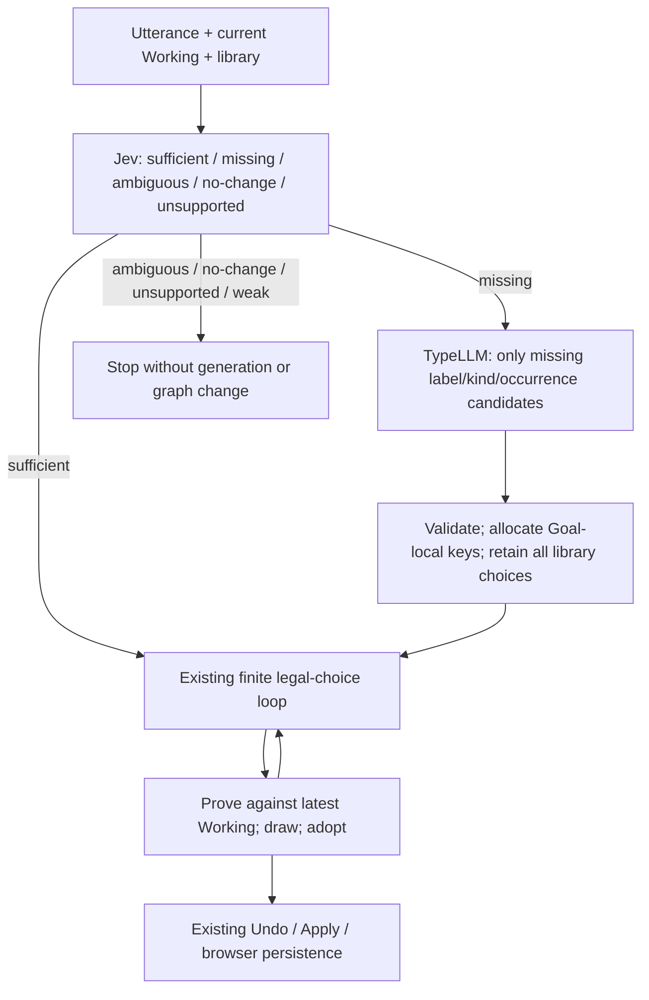
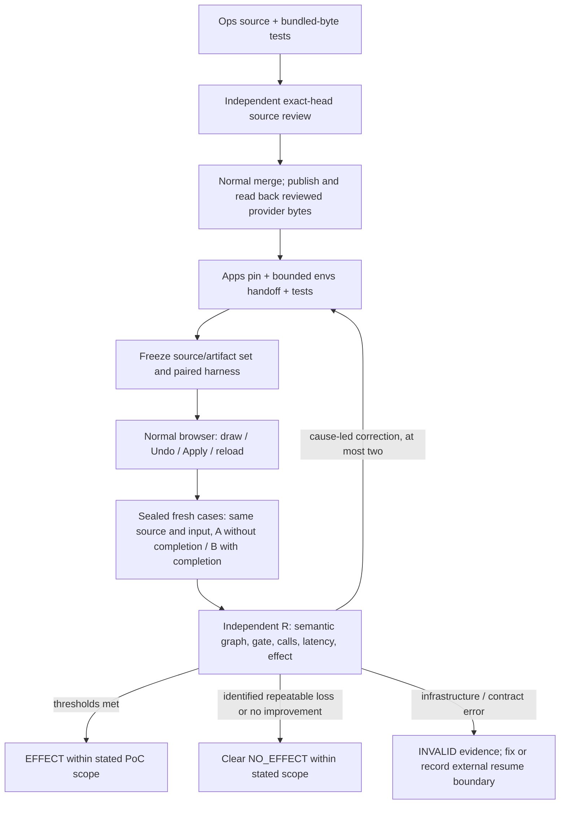

# apps

`apps` owns deployable application composition. Reusable UI capabilities, runtime packages, environment/secret authority, and deployment effects remain in their owning repositories.

## voice-ui provider boundaries

Application questions, offered choices, typed operations, confidence threshold and durable-world semantics remain in the flat voice-ui core. Explicit judgment and transcription call shapes are adopted in its existing contract; browser composition selects two small concrete adapters. The adopted UI world/schema/serialization kernel is retained, while projection can be replaced independently. These mechanical swap tests do not prove user experience, ASR accuracy or live provider success.

Jev mechanism is supplied as an exact reviewed ops ESM artifact and compiled only into the server Worker. Hayamimi is also an exact provided artifact; neither provider consumes an ops source checkout or rebuild. The UI producer source pin at 8a295d78ad6a6930608b1ad388c896ea49039102 (the ui#317 head, now normal-merged into ui proposals as b9a360a81d7c2eae8077d5cfe2e324d0d8a1f51c) remains an explicit exception: this is not an all-repository artifact-only claim. /api/judge returns typed application answers, not raw provider model/error bodies. JEV_API_KEY and the jev-api capability are unchanged, Worker-only requirements. The target composition binds the supplied ops capability once per request; ordinary app operations receive no key. Ops owns the auth/HTTP mechanism, while the target remains the physical credential holder. Nonsecret availability only preserves the pre-JSON 503 gate: it is not proof of authenticated upstream success.

Producer assembly precedes the target-owned SOPS child. Dev consumes the produced Worker; a consumer of the formal artifact does not build, install or check out source. Input ESM identity and compiled Worker identity are recorded separately. Publication supplies PRODUCT and ACCEPTANCE as six assets; a later ops convergence stage supplies DEPLOY and a fresh same-object gate. New identities require new evidence; old artifacts and real receipts are not inherited.

The same server source is also supplied as PRODUCT `e2e/serve.mjs`. Its fixed `--formal` mode derives the PRODUCT root from its own location and serves that exact site and compiled Worker; there is no formal-root environment override or caller-selected program. The formal target route must first use the provided DEPLOY admission and verify the formal PRODUCT/ACCEPTANCE closure, then start the fixed provided acceptance entry with this server in one secret child. Direct arbitrary Node invocation is not that admitted route. Source-dev mode remains legal with assembly before secret injection, but is a separate evidence grade and cannot replace same-formal-byte acceptance.

## Controlled Proposal acquisition (development only)

The existing `nix run .#dev` host can acquire ranked typed Proposals from
the installed `semcmp` command. The package definition is sourced from
`roccho-org/ops@50bd8a674ca6c13d45cb362c6bc1b6e18659f8eb` and
built into the app's Nix runtime closure: no adjacent ops checkout or working
directory is consulted. This fixed-revision `fetchGit` pin is in `flake.nix`;
it does not add another flake input, so the existing `flake.lock` is unchanged.

Supply all three operator-only settings to enable `POST /api/proposals`:

- `VOICE_UI_PROPOSAL_MODULE`: trusted, absolute ESM module path exporting `propose(query)`.
- `VOICE_UI_PROPOSAL_JEV_URL`: explicit loopback HTTP *controlled test* endpoint.
- `VOICE_UI_PROPOSAL_TEST_KEY`: separately owned synthetic key; not the Worker key.

`VOICE_UI_SEMCMP_BIN` is set by the installed Nix app, never by an HTTP
request. Request: `{"query":{"input":...,"state":...,"focus":...}}`.
The output echoes the exact query and keeps the ordered original opaque IDs,
typed `meaning`, `representation`, and computed Jev `evidence`. No configured
proposer means a 404, not a default catalog or `/api/judge` fallback.
Malformed input, invalid CLI output and timeout fail closed without exposing
private provider diagnostics. The configured proposer is *trusted operator
code*, not a sandbox for user-supplied modules.

An optional `VOICE_UI_PROPOSAL_B` is an opaque operator-provided data locator
passed through the bounded child environment to the configured proposer.
It is **independent** of the executable module path and is never inferred,
opened, mutated or treated as accepted/current by this controlled slice.
The real B owner, format and effective revision remain unresolved in ADRS #577/#506.

Formal PRODUCT's `e2e/serve.mjs` intentionally does not contain the dev
`proposals.mjs` dependency. Formal mode never imports it or offers this route;
the existing Worker `/api/judge` and its capability contract remain unchanged.
The tests are controlled/synthetic only. They do **not** demonstrate real
B/current source, Jev quality, Direct/Voice sharing, UI selection/Working,
physical host acceptance, authoritative Accepted state or edits retirement.
Any real provider/host binding must be separately authorized at ReadyLive.

## Voice-ui: candidate sufficiency and TypeLLM PoC

This PoC tests whether the executable parts are present, and fills missing
candidates before asking Jev to select legal changes. The reusable provider
transport/typed-answer core is in ops. Apps pins completed, reviewed Worker
release bytes and owns the meaning of parts, quantity, placement and graph edits.

The tested target starts inside an existing named group and adds at most three
regions and one directed flow edge. Empty-map/root construction, new operators,
arbitrary complex graphs and source architecture synthesis are outside this PoC.
Ordinary Send and source-scoped Goal keep their existing paths.



One gate call precedes the existing maximum-eight-call Goal loop. It uses one
absolute 180-second dispatch deadline; an already-started bounded provider call
can finish after that deadline, but no later call or adoption is started.
That single Jev POST batches two questions: intent (change / ambiguous /
no-change / unsupported) and inventory (sufficient / missing). Both answers
must be valid. A change uses the weaker confidence; other intents use their
own choice/confidence. The existing0.5 floor and five-choice app API remain.
The gate does not interpret NONE/low confidence as missing candidates. TypeLLM
runs at most once, on a confident missing verdict, and returns at most three
`{label,kind,occurrence}` instances. Occurrences for identical label/kind pairs
are consecutive from1; the app allocates keys and graph IDs. Display labels are
exact part labels, with no ID suffix. No generated operator, parent, edge, raw
graph or persistent dictionary is accepted. The persistent bundle retains its
eight-part cap; a validated Goal-local catalogue can contain those eight plus
three extra instances. Undo/Apply persist only the existing DecisionLog effects.

### Agreed evidence process



The first holdout was sealed by the independent reviewer before any case-level
provider output: SHA256 `22e47667ba3d6eaf1061c058b7f3e8fe07824dd3885b24264603a2be0b1f2c32`.
Its10 cases contain four sufficient tasks, four missing-candidate tasks and two
ambiguous/no-change controls. Oracles never enter prompts or candidate generation.
Both arms run the same gate and legal loop. On missing, A still runs the original
unaugmented catalogue; it is not forced to stop by the comparison harness.

EFFECT requires accepted gate correctness at least9/10 in each arm, with all four
missing gates correct in each arm; no TypeLLM call on sufficient/control cases;
zero control mutation in both arms; B sufficient
exact graph success at least3/4 and no worse than A; B missing exact success at
least3/4 with at least two more successes than A, and minimal missing-candidate
completion in at least3/4 missing cases. Exact graph means labels, kinds,
counts, parents and edge direction, with no extra semantic records. After tuning
on exposed failures, a fresh confirmation is required. Infrastructure failures,
partial graphs, a call-cap stop or merely passing source tests do not prove
NO_EFFECT or EFFECT. Final evidence and the independent verdict remain required.
Gate correctness requires the coordinator to accept the expected choice at its
existing minimum confidence; a matching raw choice stopped as undecided is not
a successful classification. Raw choice, confidence and stop reason are retained.
The fresh four-case confirmation was also sealed before any main-case output:
SHA256 `f92f733785ef8796eeed83c4880aa6481a32b4a8c2904a5292f5daaab6519fa2`.
It has two missing, one sufficient and one control case. After a correction it
requires every gate correct, both missing graphs exact and both completions
minimal, with at least one gain over A, sufficient non-regression and zero control mutation. No extra live round
is required if the first frozen main round already demonstrates EFFECT.

Before live freeze, Worker emission must pass the raw-byte relocation check.
After measurement, a report-only change in `docs/` and this README may close
the evidence without repeating provider calls only after the same R audits its
allowlisted diff, full CI, normal merge/tree, release readback and the complete
ordinary execution closure. Worker, browser HTML/code/config/bundle, dev and
packaged server, provider/renderer dependencies, harness/inputs/order and auth
runtime settings must retain their measured bytes/meaning. Permitted differences
are individually listed commit/provenance identities, the architecture source
commit and corresponding digests, and launcher store paths whose targets retain
those same bytes. Any execution difference needs a new freeze and appropriate
retest. The report keeps the original measurement time, source tuple and budget
history; it does not claim a new live measurement of the later formal release.

### Local execution through envs

`TYPELLM_API_KEY` is authored in envs, alongside the existing Jev ciphertext, for
the existing own target identity. No API key or private age identity is copied
into this checkout. On own, from a normal directory outside the Nix store, build
the exact Windows source's `jev.typedLaunch` with its pinned Nixpkgs:

```sh
nix build --impure --no-link --print-out-paths --expr '
  let s = builtins.getFlake "git+https://github.com/roccho-dev/windows?rev=<WINDOWS_SHA>";
      p = import s.inputs.nixpkgs { system = "x86_64-linux"; };
  in (import (s.outPath + "/oci/dev/nix.nix") { pkgs = p; }).jev.typedLaunch'
/nix/store/<built-launcher>/bin/voice-ui-typed-dev \
  --envs-sha <CURRENT_ENVS_SHA> --apps-sha <EXACT_APPS_SHA> \
  --port 18845 --jev-limit <RESERVED_JEV_CALLS> --typellm-limit <RESERVED_TYPELLM_CALLS>
```

This explicitly selected source-dev tool checks both current ciphertexts, fields
and the same single target recipient, builds the exact apps program before
decrypting, and hands the two keys to one child through descriptors3/4. Only
stdio remains open. It is not added to a global profile. The fixed preload
permits only the two provider POST endpoints, refuses redirects, and journals
each send synchronously before fetch. It has independent process allowances.

The run owner reserves allowances in the run journal before launch, keeps the
whole-run caps at Jev300 and TypeLLM300 including failed/timed-out/uncertain sends,
and reconciles unused allowances only after the process has stopped and its send
log is checked. Restarting must not reset the whole-run counts. The first paired
phase is capped at200 total Jev calls including all prior connectivity/diagnostic
and browser calls, leaving at least100 for corrections/confirmation. The initial
TypeLLM envelope is21 total calls. For example, after3 actual calls to each
provider, reserve at most197 Jev and18 TypeLLM calls for that phase. No automatic
retry is enabled.
Forward an unused Windows loopback port to own's18845 to open the local app.
