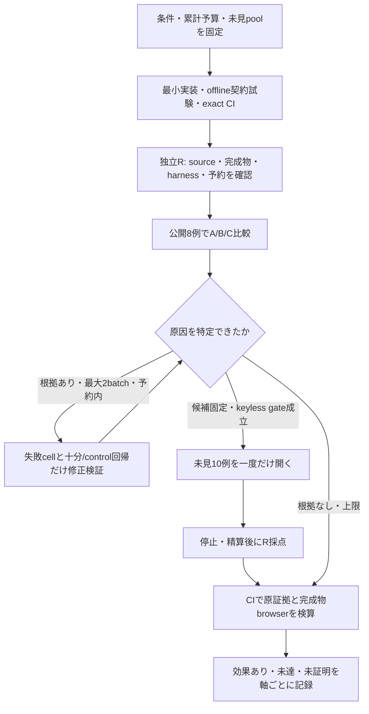

# 候補準備方式の比較と CI の証明範囲

対象は [apps#94](https://github.com/roccho-dev/apps/issues/94) と [三点補正](https://github.com/roccho-dev/apps/issues/94#issuecomment-6231599715)。旧 PoC の成功・失敗・予算を引き継ぐ。User が指定した root と継続独立 subagent 一名の組成で行い、新しい評価サービスや辞書は置かない。

独立 R と実装開始前に、次の工程と `packages/voice-ui/acceptance/candidate-plan.json` の有限条件を合意した。root が実装・provider 呼出しを担当し、R は評価対象を変更せず、別 worktree で oracle・採点・原証拠確認を担当する。GitHub 投稿 principal は同じであり、別アカウントによる承認とは扱わない。

## 比較する差分

- A は八つの既存候補のみ。不足判定後も通常の合法選択を実行し、強制失敗させない。
- B は kind + 引用名、引用名の列 + 「という」+ kind、既存名 + 十進個数 + 追加という有限の文法を保守的に転記する。kind は既存の有限 kind と DataBundle の label から取得する。例ごとの名称辞書、自由文の解釈・命名・親子/辺の生成はない。未対応の言い方は意味上の STOP として採点し、モデルへ迂回しない。原文 span を保存する。
- C は一回の TypeLLM POST で最大三つの異なる不足 pair と個数を準備する。旧配列の最初の一種類で終わる失敗に対し、三つの ordinal を明示した固定 slot を検証する。未使用 slot、重複、穴、総個数超過は厳格に検証する。改善はまだ実測していない。
- D の通常 Sys2 は費用未承認で実行しない。A/B/C の暫定比較から四方式比較完了や TypeLLM 固有の優位を推定しない。

全 arm が同じ初期 log bytes、八部品、gate、0.5 floor、合法選択、証明、180秒期限を使う。追加は既存名前付き group 内の三 region・一本の flow まで。名前、kind、個数、parent、辺方向、余分な要素の不在と既存の意味保持を採点する。ASR 後の文字列が対象で、マイク精度は対象外。

公開例を修正に使い、未見を一度開いたら以後の未見には使わない。R は新 pool を独立封印し、未消費 pool は公開しない。修正後に新候補を評価するには未消費入力と新しい予算予約を必要とする。

## 予算と判定

既計上 Jev292／TypeLLM18 を含む各1,000上限。公開216 Jev、原因修正最大二回各60、最終未見270、setup/lifecycle48を割り当て、worst total946／未割当54とする。Type は当 tranche worst84。最終未見の予約を途中修正に流用しない。失敗・timeout・不明を含む物理送信を計上し、自動 retry はしない。既存の一つの journal/lock へ予約し、所有 process group の停止確認後に精算する。

最終暫定方式は gate10/10、十分4/4かつA非劣化、不足完全一致4/4かつ最小4/4、control不変2/2、十分/controlのType呼出し0を必要とする。C採用の根拠には不足の完全一致でBより一件以上・Aより二件以上の改善も必要。B/Aが同等に満たすなら小さい方を選ぶ。POST数を通貨費用とは呼ばず、usage/価格の検証がなければ `COST_NOT_MEASURED` とする。

`EFFECT` は事前条件を満たして再現した有限範囲、`UNMET` は有効な測定での基準未達、`UNPROVEN` は未実行・評価不能・証拠/疎通不足を表す。CIの証拠検算成功を製品性能の合格と混同しない。

## CI と実 API の境界

三つを別の証拠軸にする。

1. CI 内の keyless 完成 ZIP / real Chromium / UI controls の機構試験。
2. 既存 envs → own launcher による自動実 provider 比較。
3. CI による、その停止・精算済み実測原証拠の検算。

既存の GitHub-hosted CI から own 専用 identity へ到達する正規 route は確認できていない。秘密鍵を移送せず、own 実行を CI-origin と呼ばない。このままでは `CI_LIVE_EXECUTION=UNPROVEN` であり、四方式の全条件を CI のみで閉包したとは主張しない。

描画は実配布 ZIP を検証して real Chromium 1280×720、DPR1、固定 runtime/font と overview→named-group camera の順で観測する。意味データ一致・SVG存在・スクリーンショット取得だけでは合格にしない。同名 instance の対応、label全体とclip/viewport、shape containment、見出し/兄弟の重なり、実際の描画辺の端点/方向、Undo/Apply/reload、および壊した反例を検査する。未知のSVG grammarや対応付けは未証明。失敗後の camera 調整、人手目視による合格補完、任意の図の美しさへの一般化はしない。

実呼出し前の機構試験で、大きな親境界の空白まで縮小すると固定 screen font の見出しと子 shape が重なること、内部 label clip が glyph 上端を切ることが判明した。UI は boundary title のみ tight clip を外し、普通の cell/lane は保持する。apps は populated group の原点・固定 title allowance・全 direct child の実 layout box を固定32 marginで収める。空 group は中央 label を持つ collapsed node なので full box を収める。常に scale≤1、意味・pin は変えない。未使用の親境界全体の viewport 内表示は保証しない。実 title/全 child shape/whole glyph の条件は引き続き厳格に検証し、長い名前は未達になり得る。

release CI は生成した完成 ZIP を展開して member 同一性を確認し、その展開先から Worker/site を実行して機構 receipt を保存する。通常の Nix check も同じ keyless browser gate を実行する。実 provider 比較後は、消費した全 arm の停止済み log を normal restore で完成物へ読み戻す。replay の証拠検算成功と、描画の PASS／UNMET／UNPROVEN は別である。overview は復元・意味不変の確認に限り、閉じた子の可視性を推定しない。
