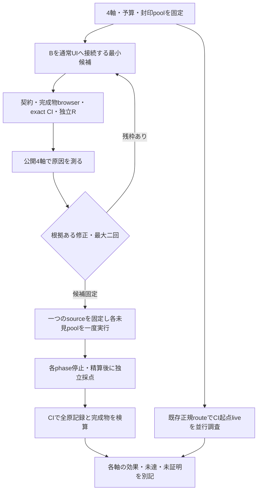

# 部品がそろう場合の表現と、不足をそろえる性能

apps#94の次cycle。前cycleの原記録・二修正・一回の未見評価は閉じたまま保つ。Userが「揃っているなら描写できるか」「揃っていなければ揃えられるか」を明確に分けて反復することを承認した。rootが唯一の実装・provider呼出し担当、継続subagent一名が独立評価を担当する。規約はadrs a6284e58ed99243447e135828d983fc07d2d363e、既存Apps#103/UI#362系列で進める。

## 一回の未見実測結果

全4軸の実行・停止・独立採点が終わった。以下の意味評価と、原記録の整合性・CI再描画検証を分ける。CIで全原記録を閉包する最終report headの検証は進行中。

| 軸 | 未見の観測 | 判断 |
| --- | --- | --- |
| G 充足判定 | accepted intent 9/10、明確なavailability 7/8、正規化gate 8/10、completeness 8/8 | UNMET。未認識1件と、正しいraw判断でも低確信で受理不可1件 |
| R 部品充足時の表現 | 正解部品の在庫8/8十分、期待構造8/8、実描画8/8 | 有限の条件付き表現性能はPASS。任意の図や他軸の合格へ広げない |
| F 不足の補完 | B exact/minimal 3/8、TypeLLM C 4/8。C契約無効1件を分母に保持 | 全体比較はUNPROVEN。Bの5件不完全とCの既知の欠落・余分候補はUNMET |
| E 通常B UI | gate 7/10、十分exact 2/4、不足exact/minimal 3/4、control 2/2。全10のpaint/保存復元/期限はPASS | UNMET。正しく受理した7件は期待構造7/7、残る3件は不完全な要求転記で停止 |

TypeLLMのみ正解だったのはF05（APIの数量と言い換え）とF06（名前付きの判断用菱形）。Bのみ正解はF03、両方正解はF01/F02。候補を補う方針には局所的な光明があるが、C全体の優越や製品経路での効果は未証明。公開B 3/3という結果は、自然な言い換えを含む未見B 3/8へ一般化しなかった。Bの製品採用を完了とは呼べない。

Eの不成功は、R01でデータを読み落とす、R03の表示名APIを工程へ誤転記する、R06の判断ノード2個を未認識とするもの。不完全さをJevが検知して停止したため、誤採用・不要生成・Type利用は0だった。安全な停止と、求められた図を出せない未達を分ける。

実測sourceは286eb7d0bc0bdef160bda900547314aa5be3a752、分類・CI freezeはefd6f7b7904910ed99e6fcf5d7bf6f32f49f4899。全CI成功と[R9](https://github.com/roccho-dev/apps/pull/103#pullrequestreview-5558028175)後にG10→R8→F8→E10を一回ずつ開封・実行した。途中のsource変更、provider retry、失敗の除外、oracleの変更はない。元reserve10はEで消費済み。全原記録・独立producer・停止cutoffは[evidence](evidence/README.md)へ保存する。

新cycle実送125 Jev/11 TypeLLM。累計charge689/40、確認済み実送689/39（過去の未送信保守charge1を保持）、予約なし。各1000上限内で、今回のType枠11は終了。金額は未測定、CI起点liveは未証明、UI#362の明示的人手merge承認は未取得。次反復は今回の結果を閉じた後、原因・最小変更・別の未見評価・残予算を同じ一名の独立Rと改めて合意する。

## 分ける軸

| 軸 | 入力と実経路 | 成功条件 |
| --- | --- | --- |
| G 意味確定・充足判定 | stock在庫＋原文、通常API | intent10/10、明確な8件のavailability8/8、正規化gate10/10。controlのavailabilityはN/A |
| R 表現 | 独立harnessへ必要部品を全供給し、gate/補完を通さず実runGoal/legal/proofで実行 | 図8/8完全一致かつ実描画8/8 |
| F 補完 | stock在庫＋原文だけをB/Cへ直接渡す | 不足8件のlabel/kind/countがexactかつminimal各8/8。最低2件は別の自然な言い方 |
| E 製品総合 | 既定Bを接続した通常UIと完成Worker | gate10/10、十分4/4、不足4/4、control2/2、不要生成0、実描画・Goal一回のApply/reload。Undoは別keyless試験 |

Rへ供給する正解部品をG/F/Eへ渡さない。各軸は別入力で、採点oracleはそのphaseの停止・独立精算後に解放する。低確信・候補ゼロ・grammar不認識を分母から落とさない。意味上明確で小PoCの範囲にある要求は、未対応構文でも不成功として残す。条件付き成績は補足にとどめる。

Bは名前・種類・個数の有限転記のみ。recognizedとcompleteを分け、全文を消費できない追加・接続要求を「部品は十分」にしない。既存graphのnodeを追加用の在庫に数えず、一回使える部品容量との多重集合差分を取る。親子・辺・operator・IDの生成権限を増やさない。通常UIはB既定、TypeLLMはFの直接比較だけで、その成績を製品Bの成績へ代入しない。

recognized/required/spansは決定的な転記記録。complete/incompleteは、同じ一回のJev POST内で原文全体とその転記を照合する独立のモデル判断とする。構文的完全性の証明とは呼ばない。intentとcompletenessの双方が閾値以上の時だけ有限在庫差分を使い、最終confidenceは両者の最小値とする。不明はnullで実行を止め、確率1を捏造しない。F単体ではJev completenessを呼ばず、抽出の取りこぼしをそのまま採点する。

Eの通常UIはRedoを持たず、同じGoalの全decisionは一つのUndo単位である。EはGoalを一回だけ実行して全targetを採点・描画観測し、通常Apply/reloadで全targetのraw一致を検査する。Undoは同一完成物・同一UI/session sourceを使う別のkeyless機構試験三fixtureで検証する。追加のGoal再送や非公開state注入は行わない。

## 予算と工程

既計上564 Jev／29 TypeLLM、各累計1,000上限。新cycleは公開56 Jev、原因修正最大二回各27、最終164、setup16で合計290 Jevまで（累計最大854）。TypeはF直接比較の公開3＋未見8の11まで（累計最大40）。残り146 Jevはこの計画の自動追加枠ではない。失敗・不明・timeoutも一つの既存journalへ計上し、自動retryしない。

未消費の旧reserve10は原入力・原oracleのままEだけに一度使う。G10/R8/F8はRが新しく別々に封印する。公開済みN/Hを未見として再利用しない。CI-liveは起動設定・own実行・証拠検算から推定せず、正規認証・送信・精算の実証までUNPROVENとする。UI#362の人手merge承認も未取得であり、候補pinの測定と正式採用を分ける。
