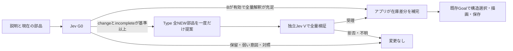

# 部品候補の項目間依存を測る別の反復

実装前登録。前回は[全30件をCIと独立Rで閉包](../requirements-cycle-20261017/closure.md)し、Vの公開回帰6/6、F2/6・形式不正4件、製品Eの効果未証明で停止した。前回の2修正・失敗・未見6ファイルの封印を変えず、この反復を別登録する。現時点の累計は課金上701Jev/58TypeLLM、確認済み実送701/57。追加の実API送信は0。

同じ独立Rが[評価仕様](preregistered/dependency-cycle-protocol.md)・[commitment](preregistered/dependency-cycle-commitment.json)（SHA256 `8d00c900e13b755a3cf467643e17e6a961581ad6e40ee105896fdce78038edff`）を実装前に固定した。[公開ファイルのhash一覧](preregistered/dependency-cycle-freeze.json)だけをコピーし、新しい未見V10/F8/E10と旧未使用6ファイルはR側で封印を維持する。[検算記録](preregistered/dependency-cycle-seal-validation.json)はPASSで、公開E2と新しい未見M4のliteral抽出不足も実APIなしで確認済み。

新しい仮説は、TypeLLMへ同じ質問を渡しながら、種類→名前→数量→次の組へ先の回答を参照させること。現行の3object/9scalar、質問文・文脈・型・出力位置を保ち、depends_onだけを変える。以前の無効出力の内部値は取得しておらず、独立した項目処理がその原因だったとは断定しない。

[Ops#565](https://github.com/roccho-org/ops/pull/565)はgenericな依存関係の検証を3ファイルで追加した。source/full CI/完成ESMと[独立R1](https://github.com/roccho-org/ops/pull/565#pullrequestreview-5558945175)を確認し、レビュー済みtreeと同じ内容をb4f611cac9e13fbef178469796cbc3b6d4a76b23へmerge済み。[canonical CI](https://github.com/roccho-org/ops/actions/runs/39052107450)・[正式publisher](https://github.com/roccho-org/ops/actions/runs/39052924181)が通過し、[公開4assets](https://github.com/roccho-org/ops/releases/tag/jev-provider-b4f611cac9e13fbef178469796cbc3b6d4a76b23)を匿名で取得してsource/proof/provenance/entry検証まで確認した。Apps完成配布物への組込みと、新しい候補性能は未実証。

[公開bytes読戻し](supply/root-readback.json)と[既存Apps受入器の正例1・拒否例8](supply/apps-admission.json)はPASS。Appsの依存pin更新・完成Workerへの組込み・新しい実API性能はこの後に確認する。

| 性能 | 与えるもの | 判断すること |
| --- | --- | --- |
| 表現 R | 正しい部品在庫と説明 | 既存Goalが構造を選んで実画面へ描き保存できるか |
| 初回G0 | 説明・有限在庫・Bの観測 | 充足・不足・保留を実際にどう判定するか |
| 検証 V | 説明と全NEW部品案 | 正しい案を受理し、欠落・余分・種類・数量誤りを拒否できるか |
| 補完 F | 同じ説明と質問、依存指定の有無 | 必要な部品全量を正確に揃えられるか |
| 製品 E | 同じ説明・開始図・在庫、literal抽出のみ/Type解釈付き | 完成図・描画・保存と、解釈不足を補う経路による改善を別々に測る |

TypeLLMは部品全量だけを出す。在庫差分・一度だけ使える個数はアプリが計算し、親子・矢印・ID・操作は既存Goalが所有する。literal抽出だけで必要全量が判明すれば、在庫が不足していてもアプリが決定的に部品を用意できる。「必要な部品を読み取れたか」と「在庫が揃っているか」は別の判定であり、TypeLLMの効果は前者の不足に対して測る。

評価・予算・停止工程は[protocol](protocol.md)。新しい独立封印・wire合意・実装・正式artifact・完成配布物CI・実PID/送信0の受入が揃うまで実API試験へ進まない。既存のenvs正規経路を使い、キーの再入力・コピー・新しい認証経路は追加しない。UI PRの明示的人間merge承認条件も維持する。
