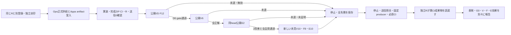

# Dependency mechanism: preregistration contract

Status: root and the same persistent independent R agreed the boundaries below before the new Apps mechanism, new evaluation implementation and any paid call. Sealed projections/oracles and their commitment must be published and independently read back before implementation proceeds. This document is not a live GO.

The previous cycle remains closed at Apps1f51623a1c3cc64614b5940eaff60fa4b6837cea and R14. Its two corrections,30 executions, every failure, frozen scorers and six unconsumed fresh files remain intact. The new mechanism is the generic bounded dependency capability reviewed in Ops565. Capability/scheduling conformance does not establish the cause of prior invalid values or semantic efficacy.

## Small product and wire

- Preserve the actual initial Jev G0, all four factors and the existing.5 acceptance floor. Type runs once only for accepted change plus incomplete; complete accepted B and controls use Type0. V checks the proposed total NEW requirements before the app subtracts one-use stock. Existing nodes never replenish stock. Goal/legal/proof/Apply/reload and graph authority are unchanged.
- Keep the three objects/nine scalars, full NEW meaning, every instruction/context/enum and nested answer path. The dependent version adds only local label depends_on[kind], quantity depends_on[kind,label], object2 depends_on[object1], object3 depends_on[object1,object2]. The independent comparator removes only depends_on. No flattening, array restart, semantic repair, deduplication or response retry.
- Direct F uses `/api/parts/requirements?generation=independent|dependent`. Absent generation means dependent. Reject unknown keys/values and duplicate query parameters before any send. Both arms use the same compiled extraction function/context. Preserve the approved v2 HTTP tuple/inspection meaning.
- Normal adaptive-v2 uses the dependent generator. E B stays literal-v2: literal-only interpretation without Type. Both arms retain the existing deterministic stock-difference preparation, including recognized missing rows. E C uses normal adaptive-v2 with default dependent generation. There is no E generator override. Legacy routes remain separately identifiable. Approved receipts prepare candidates once without another Type call.
- Add a closed generation enum to TYPE_REQUIRED stdout for valid and invalid results. Its value must join the actual F query, new raw policy, request_id and fixed producer. E's Type stages must be dependent; B/V must have no Type stage. Keep raw upstream bodies/headers and rejected unknown scalar values out of logs. Existing shared40s check/abort, one HTTP versus actual provider sends and whole-Goal deadline remain distinct.
- Same existing envs launcher/strict send guard/cumulative ledger/manager. The server-only manager is not reused for CLI; no source fallback, provider replacement or new secret route. Only formally published, verified completed Ops bytes/proof enter Apps.

## Independent schemas and arms

Use `voice-ui.dependency-cycle-{input,oracle,cell,execution,phase,producer,process}/1`. Each input case has exactly one explicit arms array; no legacy schedule alternatives. Bind input/oracle/raw/runtime/source/config/process/actual URL/stage/producer to the exact published commitment and candidate source. Top-level parent_inputs_sha256 and parent_oracle_sha256 are required, with null for fresh pools.

| Input | Arms and fixed order | Closed raw generation_policy |
| --- | --- | --- |
| Public F6 | odd[I,D], even[D,I], one phase with12 executions | I independent, D dependent |
| Final F8 | [D] | dependent |
| V | [V] | null |
| E | odd[B,C], even[C,B] | B null, C dependent |

C's policy remains dependent even when an eligible Type invocation is unnecessary and the actual Type count is0. A policy is not evidence that a request occurred. All public case semantics are immutable copies of the prior public F6/V6/corrected E2.v2, with original input/oracle hashes retained as parents. New wrappers add only their explicit schema/arms. New final V10/F8/E10 pools are independently sealed before Apps implementation, kept private until admission, and do not consume the previous cycle's unused pools.

I/D share method full-required; V uses verify; B/C use literal-v2/adaptive-v2. The F arm, generation_policy and explicit actual generation query must all agree. Only the normal default is used in E.

R owns the independent new scorer/auditor/tests, seal and fixed stopped producers. Root is sole product writer and paid caller, and owns HTTP/driver/CI integration. Reuse frozen pure semantic grading and expected meanings; do not silently regrade old raw or promote old invalids. The public F12 report retains both six-case denominators. A validity gain is separate from an admissible semantic causal gain; an invalid independent arm cannot count as a semantic causal win.

## Gates and meanings

1. Exact provider source/full CI/completed-ESM review; reviewed/merged tree equality, canonical push CI, formal publication and public byte readback; explicit Apps artifact admission.
2. Publish/read back this registration, source identities and independent seals; implement and verify the actual default/ablation payloads, completed app artifact and required CI; independent source admission and actual zero-send PID/start/caps/guard binding.
3. Run all public F12 once. Candidate D6 must all execute validly and score exact/minimal>=4/6. Keep every I/D result; independent invalids never shrink the denominator.
4. Candidate public V6 must be correct6/6 with false acceptance0. Same-head public E2 must satisfy full enabled quality and both eligible missing gains.
5. Only after all candidate public F/V/E gates pass on the same measured source may any newly sealed V/F/E input be released. Run final V10, F8 and E20 executions once with source/criteria frozen.
6. Stop and independently reconcile all owned groups, including zombies. Retain every invalid/failed cell and exact journal cutoff/fixed producer. Required keyless CI rebuilds/reopens the exact recorded artifacts, joins all raw/provider/source/accounting evidence and repaints/regrades E. Independent R checks the actual CI artifacts and terminal identities.

Final V requires10/10 correct, false acceptance0. Final F requires exact/minimal8/8 with trueS2 adding0, reporting interpretation cost separately. Final E has S4/M4/controls2, including B-known/natural forms; all four M cases must have a genuine literal extraction deficit confirmed keylessly before sealing. Known part definitions and a complete literal interpretation are separate properties. Full enabled target/paint/Apply/reload/deadline quality must pass for all10 cases. Causal missing effect needs>=2 gains, regression0, false adoption0 and every guard. Each pair needs both actual G0 decisions to be eligible; disagreements/weakness are excluded only from causal attribution and remain in full product-quality denominators.

E's causal claim is the dependent-Type interpretation path versus literal-only interpretation, with deterministic stock preparation retained in both. It is not dependent-over-independent-Type end-to-end superiority. Only a complete valid registered missing comparison with0gains and the full eligibility/guard conditions can support NO_EFFECT_IN_REGISTERED_MISSING_CASES. Otherwise effect stays UNPROVEN. Public/regression improvements never establish unseen generalization. Supplied-parts R may be reused only with the actual Goal/core6 and renderer/protocol bytes unchanged; new E paint is still required.

## Budget and bounded stop

Start at charged701Jev/58TypeLLM, confirmed701/57, retaining the historical conservative unsent Type1. Global cap1000 each. Proposed registered cap250J/40T gives maximum cumulative951/98.

| Stage | MaxJ | MaxT |
| --- | ---: | ---: |
| Public I/D F6 each |0|12|
| Public V6 |6|0|
| Public E2 |38|2|
| Final V10 |10|0|
| Final F8 |0|8|
| Final E10 paired |190|10|
| Setup |4|0|
| Allocated |248|32|

Inside the cap2J/8T remains unallocated; outside49J/902T remains unallocated. No reset, second paid caller, automatic leftover allocation or response retry. Reserve before launch/send and reconcile against actual sends after physical stop. The new process starts after the exact final old cutoff64e3f3f25294e1e9464c381f59868a7aee17899cf47381065138fbbd3c1b63c4, checks baseline701/58, and indexes every subsequent reserve/cutoff in order, with no omissions.

No post-public correction/retest source batch is allocated. Any required product/evaluation-source or semantic change after the first public call stops this registration as UNMET/effect UNPROVEN. No successful cell carries across source. Pre-live source/CI repair spends no model allowance. Report-only docs/index and predeclared revision/architecture metadata may follow measured output, but measured source/grades/criteria stay fixed and CI must check each actual recorded artifact. Failed gates keep every new final pool unreleased; do not burn it merely because budget remains.

