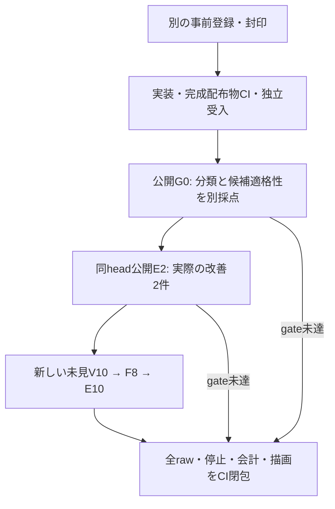

# 低確信の入口から候補を補う：実測と未達

部品が揃っている場合の表現性能と、揃っていない場合に補う性能を分けて評価する。今回の仮説は、抽出不足を十分な確信で認めながら意図の確信度が低い場合、TypeLLMの案を一度だけ作り、独立検証へ渡すと改善するかである。測定source 2cc4890b765a5534e92855f83f9232ae85bb373bで全52試行を実施した。公開例では改善したが、未見比較は両方式5/10で、**新policyの効果は未証明**。全試行と失敗を保存してCIで再計算する。

前回は[報告664c8a8](https://github.com/roccho-dev/apps/tree/664c8a8d4598471327a8b330afd416b3f9eb86e0/docs/voice-ui/intent-cycle-20261018)・[独立R18](https://github.com/roccho-dev/apps/pull/103#pullrequestreview-5559763705)で閉包した。G0の正解8/10は未達のまま維持し、分類の正誤を新しい候補適格性の判定へ置き換えない。従来R8/8は同一Goal/core6・実UI238/renderer231による有限・条件付きの表現性能で、今回の補完効果ではない。

## 測定結果と区別

| 評価 | 観測 | 判定 |
| --- | --- | --- |
| 部品が揃った後の有限・条件付き表現 | 既存R8/8。今回もcore6・実UI238/renderer231は同じbytes | 既存の有限範囲で実証。今回の自然文全体の性能とは分ける |
| 公開G0・候補policy | 10/10。元の充足・意図分類は8/10 | policy gate PASS、分類はUNMET |
| 公開E・補完あり/なし | C2/2・B0/2、改善2・新frontier改善1 | PUBLIC_REGRESSION_ONLY |
| 未見V・提案の独立検証 | 9/10、誤受理0、正しい提案の誤拒否1 | UNMET |
| 未見F・要求の生成 | 全8件中7件が有効かつ完全・最小、HTTP502失敗1 | 全体品質UNPROVEN、観測基準UNMET |
| 未見E・図全体 | C5/10・B5/10。Cは充足2/4、不足1/4、変更しない対照2/2 | 品質UNMET、補完経路の効果基準UNMET |
| 未見E・新policyの追加効果 | 実改善1件は旧適格条件の経路。新frontier改善0、回帰1、誤採用1 | frontier効果UNPROVEN。効果なしの条件も満たさない |

公開例と未見の結果を合算しない。Fの失敗を除いて7/7へ読み替えない。CIの成功は証拠の整合性と同じ判定の再現であり、性能の未達を成功へ変えない。全20件の未見Eは有効実行・実描画・保存・180秒以内を確認し、同じ完成配布物からの鍵なし再描画も20/20 PASSだった。描画できたことと、依頼に合う図になったことは別である。

未見EのFE01は同一質問でBの意図change.53、Cのno-change.31となり、Cだけ入口で停止した。両方Type0・候補policy対象外なので、paired回帰として残し、新policyが悪化させた機構的証拠とはしない。FE07ではTypeが「稟議可否」decision1を正確に提案し、Vも受理した後、Goalが不要な在庫「判断」を追加した。これは提案の誤りと組み立ての誤採用を分けて記録する。FE05は正しい要求表を作れたが、Vのcomplete.14で止まった。

未見VのFV05も正しい提案に対してintent change.48で拒否した。固定閾値.5は変更しない。未見FのFF05はHTTP502 parts_contract、評価結果はevaluation-operation-unknownで、構造失敗の詳細はNOT_RECORDED_UNKNOWN。原因を推測で確定せず、再試行しない。

## 小さな完成形と役割

最大3種類・総数3個のNEW部品を扱う既存POCを使う。Typeは名前・kind・NEW数量の案、独立Vは原文との対応、アプリは在庫差分、既存Goalは合法な構造・接続・ID・操作を担当する。Ops#565の正式providerをAppsが使う。質問・文脈・parser・閾値・Goal・rendererは変更しない。

新方式は明示的なadaptive-v3/inspection3/stage3とし、元のG0判定・factorを保持して候補生成の理由を別に記録する。案の生成は図を変える権限ではない。強いambiguous、no-change、unsupported、complete、弱いcompleteness、不正なfactor/通信失敗は停止する。有限parserの空・無効な抽出自体は原文の曖昧さと区別する。旧literal-v2/adaptive-v2とinspection2は残す。

製品差分はcompletion・parts API・Pages entryの3ファイル。新driverは従来callerの固定経路を再利用し、独立score/auditを含む25sourceを記録する。新しい必須CIは未測定indexも検算し、完成ZIPで弱い入口からの実C経路・拒否/低確信/不正V・版の混在拒否・閾値grid・共有deadlineと、親WorkerとのG0/F/V原送信bytes一致を確認する。これらはkeylessな疑似試験で、実モデル性能には数えない。

実送前source0e6add5の[Nix39065864834](https://github.com/roccho-dev/apps/actions/runs/39065864834)は、既定経路のcompiled API testが旧adaptive-v2を期待して失敗した。既定v3/inspection3と導出policyを確認する期待へ更新し、充足時のType-key-free・追加候補0・総呼出4の確認を維持する。評価対象25source・質問・封印・採点基準は同じで、実送0のまま、新headの全CI・完成物受入を要求する。この失敗runを削除・成功へ読み替えない。

[release39065864849](https://github.com/roccho-dev/apps/actions/runs/39065864849)と修正head c762の[release39066114821](https://github.com/roccho-dev/apps/actions/runs/39066114821)は、最初のJevを停止させる疑似fixtureに共有40秒を期待して失敗した。正式providerのJev上限は10秒、Typeは35秒、アプリ全体は40秒であり、完成c762 Workerの鍵なし観測はJev1送・504・10097.8ms・stage0だった。製品の期限を変更せず、Jev単体10秒と、有効G0を7秒後に返してからTypeを停止させる共有40秒を別々に確認する。後者は7秒後に開始するTypeの単体35秒期限（全体開始から約42秒）より先の停止とG0のみ・Vなしを要求する。失敗runと修正理由を保存し、全CIを新headで取り直す。G0/F/V比較は両Workerの元送信・元応答も保持し、主張する同一bytesを独立に検算できるようにする。実APIの評価・予算消費はない。

## 合意した工程

rootが製品・driver・CIと実呼出を担当し、同じ独立subagent1名が新しい未見パネル・oracle・採点・監査・固定producerを担当する。未見データは工程の解放条件までrootへ渡さない。適用ADRSはa6284e58ed99243447e135828d983fc07d2d363e。

G0分類の未達はそのまま報告し、新しい候補policy gateは全10件の有効性・正規化・不変・Type0、実factorによる適格性と理由を別に確かめる。公開E2は両方とも同じheadで実際の改善が必要。未見V/Fは品質の未達や完全に保存された失敗を分母に残し、証拠・source・停止・会計が整っていれば独立した次軸へ進む。欠けた証拠や説明できない送信は進行を止める。

一般の有限Type経路の効果は、採点可能な不足案件で2件以上の改善・回帰0・全guardを要求する。新policy自身の効果には、旧適格条件では停止し新条件で候補生成へ進んだCの実改善がさらに1件以上必要。効果なしは全登録条件を満たした実機会4件で改善0の場合に限り、それ以外は未証明とする。frontier固有の効果なしには、不足4件のCが全て実際に旧条件では非適格・新条件では適格だったことも要求する。

[protocol v2](preregistered/frontier-cycle-protocol.v2.md)、[commitment v2](preregistered/frontier-cycle-commitment.v2.json)、[active freeze v2](preregistered/frontier-cycle-public-freeze.v2.json)が規範。公開G0/Eの原semantic・fixture・targetは親のintent評価と同じで、G0にはpolicy期待だけを追加する。旧未消費20原本は封印を維持する。新しい未見6原本は各停止gate後に解放し原bytesを保存する。原版とparser観測の公開前clarificationも保存する。

現在の予算計数808Jev/85TypeLLM、確認実送808/84、残予約0。過去のType1件の不確実な課金を維持する。全38の所有process groupは停止し、即時ledger cutoffはce6896e0b1eb7c3c749b659b36e3ed4467dc133042ace81dd990b9f2e10c28d4。今回の追加は83Jev/14TypeLLMで、登録最大248/20・最悪累計973/91と各1000上限内。[evidence index](evidence/index.json)に全5段階・52試行を残し、実source・provider・原HTTP・停止・会計・同じ完成物での再描画を検算する。次の改善はこのcycleを閉じてから別登録とする。未見一般化・製品採用・四方式比較・CI起点の実API・金額費用は未証明。Appsはdraft/open/unmerged、UI#362の明示的人間merge条件を維持する。[envsとローカル起動](../typellm-poc-20261017/README.md#ローカル実行と-envs)を再利用し、キー再入力は不要。
