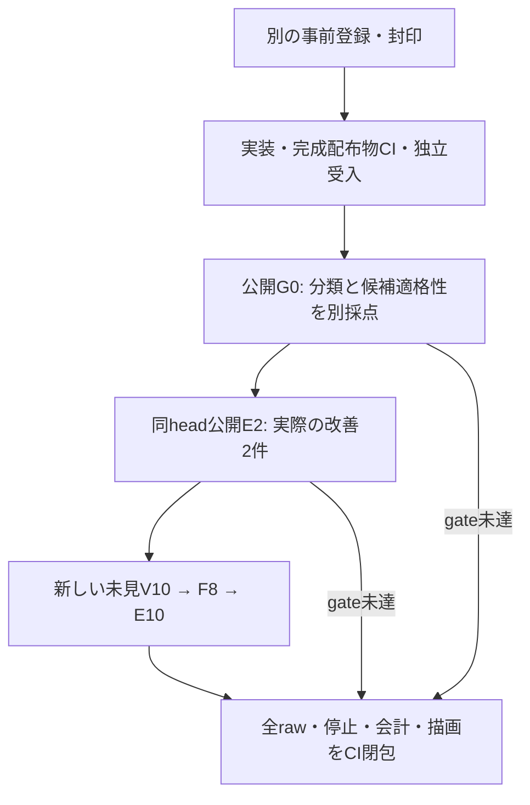

# 低確信の入口から候補を補う：実装・CI受入前

部品が揃っている場合の表現性能と、揃っていない場合に補う性能を分けて評価する。今回の仮説は、抽出不足を十分な確信で認めながら意図の確信度が低い場合、TypeLLMの案を一度だけ作り、独立検証へ渡すと改善するかである。現在は**実装済み・未測定・効果未証明**。完成配布物のCIと独立受入を経てから実送する。

前回は[報告664c8a8](https://github.com/roccho-dev/apps/tree/664c8a8d4598471327a8b330afd416b3f9eb86e0/docs/voice-ui/intent-cycle-20261018)・[独立R18](https://github.com/roccho-dev/apps/pull/103#pullrequestreview-5559763705)で閉包した。G0の正解8/10は未達のまま維持し、分類の正誤を新しい候補適格性の判定へ置き換えない。従来R8/8は同一Goal/core6・実UI238/renderer231による有限・条件付きの表現性能で、今回の補完効果ではない。

## 小さな完成形と役割

最大3種類・総数3個のNEW部品を扱う既存POCを使う。Typeは名前・kind・NEW数量の案、独立Vは原文との対応、アプリは在庫差分、既存Goalは合法な構造・接続・ID・操作を担当する。Ops#565の正式providerをAppsが使う。質問・文脈・parser・閾値・Goal・rendererは変更しない。

新方式は明示的なadaptive-v3/inspection3/stage3とし、元のG0判定・factorを保持して候補生成の理由を別に記録する。案の生成は図を変える権限ではない。強いambiguous、no-change、unsupported、complete、弱いcompleteness、不正なfactor/通信失敗は停止する。有限parserの空・無効な抽出自体は原文の曖昧さと区別する。旧literal-v2/adaptive-v2とinspection2は残す。

製品差分はcompletion・parts API・Pages entryの3ファイル。新driverは従来callerの固定経路を再利用し、独立score/auditを含む25sourceを記録する。新しい必須CIは未測定indexも検算し、完成ZIPで弱い入口からの実C経路・拒否/低確信/不正V・版の混在拒否・閾値grid・共有deadlineと、親WorkerとのG0/F/V原送信bytes一致を確認する。これらはkeylessな疑似試験で、実モデル性能には数えない。

## 合意した工程

rootが製品・driver・CIと実呼出を担当し、同じ独立subagent1名が新しい未見パネル・oracle・採点・監査・固定producerを担当する。未見データは工程の解放条件までrootへ渡さない。適用ADRSはa6284e58ed99243447e135828d983fc07d2d363e。

G0分類の未達はそのまま報告し、新しい候補policy gateは全10件の有効性・正規化・不変・Type0、実factorによる適格性と理由を別に確かめる。公開E2は両方とも同じheadで実際の改善が必要。未見V/Fは品質の未達や完全に保存された失敗を分母に残し、証拠・source・停止・会計が整っていれば独立した次軸へ進む。欠けた証拠や説明できない送信は進行を止める。

一般の有限Type経路の効果は、採点可能な不足案件で2件以上の改善・回帰0・全guardを要求する。新policy自身の効果には、旧適格条件では停止し新条件で候補生成へ進んだCの実改善がさらに1件以上必要。効果なしは全登録条件を満たした実機会4件で改善0の場合に限り、それ以外は未証明とする。

[protocol v2](preregistered/frontier-cycle-protocol.v2.md)、[commitment v2](preregistered/frontier-cycle-commitment.v2.json)、[active freeze v2](preregistered/frontier-cycle-public-freeze.v2.json)が規範。公開G0/Eの原semantic・fixture・targetは親のintent評価と同じで、G0にはpolicy期待だけを追加する。旧未見20原本と新しい未見6原本は封印を維持する。原版とparser観測の公開前clarificationも保存する。

現在の予算計数725Jev/71TypeLLM、確認実送725/70、残予約0。新登録は最大248/20（修正・再試行・setup0）、最悪累計973/91で各1000上限内。工程と[空のevidence index](evidence/index.json)はNOT_MEASURED。一般効果・未見一般化・製品採用・四方式比較・CI起点の実API・金額費用は未証明。Appsはdraft/open/unmerged、UI#362の明示的人間merge条件を維持する。[envsとローカル起動](../typellm-poc-20261017/README.md#ローカル実行と-envs)を再利用し、キー再入力は不要。
