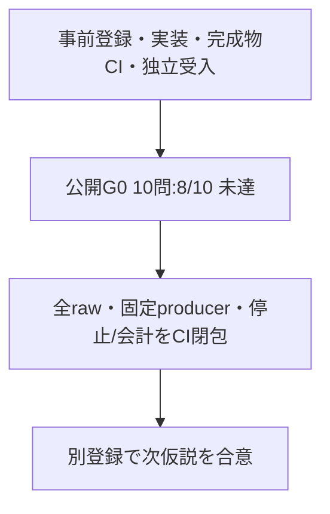

# 入口G0の文言修正：公開8/10で停止

原文の明確さと有限抽出の不足を分ける修正を測定した。公開G0は全10件有効・正解8/10で、登録した全問通過gateに届かなかった。**入口判定は未達、補完・製品効果は未証明**。公開E・未見V/F/Eへは進まず、全原記録を残してこの登録を閉包する。

測定headは `81f9f4df488e7f4fd94c63dbc15fe46ab0fb3a25`。Jev10回・TypeLLM0回を実送し、累計の予算計数725/71、確認済み実送725/70。過去の未送信Type1回分も保守的に計上している。全10件の図・head・logは不変、所有PID/PGIDはzombieも含め消滅、残予約0。修正・再試行・setup・未見解放はいずれも0。

| 軸 | 今回の結果 | 解釈 |
| --- | --- | --- |
| 入口G0 | 正4/5・負/対照4/5、全10有効・正解8/10 | 公開回帰のgate未達 |
| 部品が揃った後の表現 | 従来R8/8と同一core6・実UI238/renderer231 bytes | 既存の有限・条件付き証拠。新しい製品Eの成功ではない |
| 全量生成F・独立検証V | 新たな実測0 | 前回ae816ecの正確F5/6・V6/6を別headの観測として維持 |
| 不足補完と製品E | 実測0 | 効果・NO_EFFECTともUNPROVEN |

## 未達と背景

| ケース | 登録した期待 | 実際 |
| --- | --- | --- |
| PG01 | 明確なAPI3個追加をchangeと判断し補完へ進められる | ambiguous .39 / incomplete .96。補完適格false |
| PG10 | 未対応操作をunsupportedと分類 | no-change .75。Type0・図は不変 |

実際に補完適格だったのはPG02だけ。G0の直接literal経路ではTypeを呼ばず図も変えないため、この観測だけから補完の成功・失敗を採点しない。[独立集計](evidence/public-G0/intent-cycle-public-closure.md)、[全rawと固定producerのindex](evidence/index.json)、[閉包の説明](closure.md)を参照。

## 固定した工程と証拠

[実装前登録0bea781](https://github.com/roccho-dev/apps/tree/0bea78112600b876527f6df8aaeb8ba3d7224764/docs/voice-ui/intent-cycle-20261018)を同じ独立Rが認証読戻しした。規範は[protocol](preregistered/intent-cycle-protocol.md)、[commitment v3](preregistered/intent-cycle-commitment.v3.json)、[freeze v3](preregistered/intent-cycle-freeze.v3.json)。測定前の対照oracle形式修正とG0不変条件の明確化は元版とaddendumを保存している。未見6原本はhashを再確認し、非公開のまま維持する。

製品差分はliteralQuestionのintent追記1箇所だけ。従来18sourceは同じで、Type質問・文脈・依存、独立V、parser、在庫差分、.5閾値、Type適格条件、Goal・rendererを変えていない。最大3種類・総数3個と既存図操作の小さなPOCで、TypeはNEW部品全量の案、アプリは不足差分、既存Goalは構造・接続・ID・操作を担当する。

[R17](https://github.com/roccho-dev/apps/pull/103#pullrequestreview-5559628912)は実source22・正式Ops provider・全293配布memberと、測定前の4 CI成功を独立受入した。完成ZIPの疑似G0正常10/失敗10、新E4のpaint/Apply/reload、公開F/Vの完成Worker間送信原bytes12組の一致はSYNTHETIC_MECHANICS_ONLYである。その後に実PID/start/argv/preload・上限10/0・送信0を独立確認し、一度実行・finally停止・即時journal固定・独立採点を行った。

必須CIは[停止済み1phase](evidence/index.json)のsource/raw/provider/producer/processを再検算し、公開8/10・未達・効果未証明を保持する。測定後のsource・基準・rawは変更しない。CI起点の実API、金額費用、未見一般化、四方式全比較、製品採用は未証明。次の仮説の実装・実送は、この登録のCIと独立閉包後の別登録で扱う。

登録枠248Jev/20TypeLLMのうち使用は10/0、現在のcutoffは `efc4a61b73333efc3058c5f6d1fc90f3eaadf929160e1ad69d781a1619b5c517`。各1000上限を維持する。Ops#565の正式coreと[envs正規経路・ローカル起動](../typellm-poc-20261017/README.md#ローカル実行と-envs)を再利用し、キーのコピー・再入力は不要。Appsはdraft/open/unmerged、UI#362の明示的人間merge承認条件を維持する。
