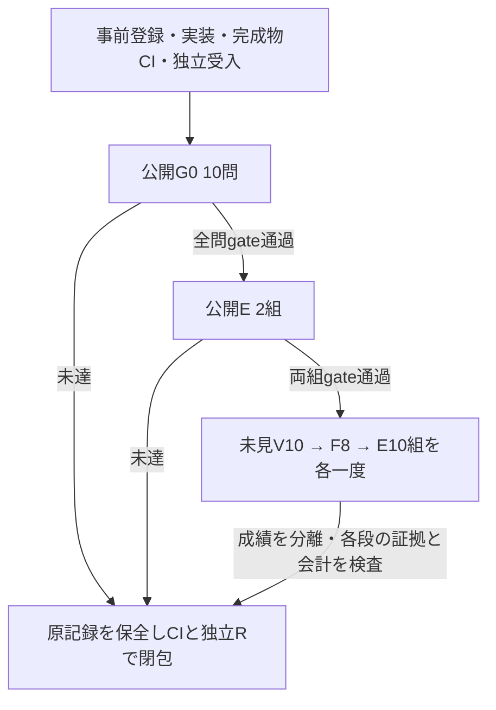

# 原文の明確さと有限抽出を分ける反復

実装前の別登録。前回は[全22実行をCIと独立R16で閉包](../dependency-cycle-20261018/closure.md)し、公開の依存付きFは正確5/6、Vは正解6/6、製品Eは達成1/2で停止した。前回の公開E未達・失敗・未見解放0を維持する。累計は予算計数715Jev/71TypeLLM、確認済み実送715/70。今回の追加実API送信は0。

新仮説は、入口G0が「原文の依頼が明確か」と「有限の抽出器が全量を読めたか」を分ければ、明確な依頼を誤って保留する例を減らせる、というもの。変更対象は `literalQuestion` のintent追記だけとする。部品を特定しない数量だけの依頼、未指定の追加部品・親・端点、変更なし、未対応操作の保留条件を維持する。質問・文脈・依存指定を含むType生成、独立V、parser、在庫計算、.5閾値、Typeを呼ぶ条件、Goal・描画は固定する。モデルがこの指示に従うかは未実証である。

小さなPOCの範囲は、最大3種類・総数3個の新規部品と既存の図操作。正しい部品が揃ってから描く性能と、説明から必要部品を揃える性能を別に測る。Typeは全NEW部品案だけを出し、在庫差分はアプリ、構造・接続・ID・操作は既存Goalが所有する。

## 固定した評価と進行

同じ独立Rが[protocol](preregistered/intent-cycle-protocol.md)と[canonical commitment v3](preregistered/intent-cycle-commitment.v3.json)を固定した。commitment SHA256は `aa5495197f05f82d6447218ac7c036626105b3f839c4b1c0544c67e08e9c1a2f`、[公開allowlist v3](preregistered/intent-cycle-freeze.v3.json)は `a8e7cd00871379bdec48bf35f2a4a4cb0f9b6eef826c43d0bcabac8d3789e528`。公開G0/E2の入力・正解は登録時に公開する。新しい未見V10/F8/E10はR側で封印し、各入力は予定した段階、各正解はその段階の実停止・送信照合後にだけ解放する。旧未使用poolは使わない。

| 評価 | 問い | 固定基準 |
| --- | --- | --- |
| 公開G0 10問 | 原文の意図と実際の補完適格性を正しく分けられるか | 正5/負5の意図全10正解、confidence>=.5、保留・Type条件・正規化・在庫差分・図の不変性を検査 |
| 公開E 2組 | 同じ説明で補完ありの実際の完成が改善するか | 両組が比較適格で改善、候補全量・図・実paint・保存・期限・guardを達成 |
| 未見V 10問 | 部品案の正否を検証できるか | 正案5・誤案5、全件有効・正解、誤受理0 |
| 未見F 8問 | 必要な部品全量を揃えられるか | 全件有効・過不足なし。充足2問の在庫差分0 |
| 未見E 10組 | 製品の充足・不足・対照を満たすか | 充足4・不足4・対照2、候補側全10達成、比較適格な不足改善2件以上、退行0、全guard |

公開G0と公開Eを同じheadで通過した後、未見V→F→Eを一度ずつ測る。未見V/Fの成績未達も分母に残し、証拠・source・実停止・送信会計が閉じれば次の独立した性能軸へ進む。証拠欠損・source変更・不明な送信・残予約があれば進行しない。E成功をV/F成功へ読み替えない。

表現R8/8は同一core・実rendererのbytesと有限条件が一致する範囲だけで参照する。旧公開F/Vの実測headはae816ecのままとし、完成Workerで送信内容の一致を証明しても新headの測定へ付け替えない。公開F/Vの実API再試験は割り当てず、新しい未見F/Vを一度ずつ測る。

## 測定前の修正履歴

公開前・製品変更前・API送信前に、未見Eの曖昧な対照1件で、未解決の必要部品欄と「図を変えない」期待値の形式が矛盾することを独立検査で発見した。[明示addendum](preregistered/intent-cycle-prelive-control-addendum.json)でその欄だけをnullへ修正し、元input/oracle・commitment・freezeはすべて保持する。入力側の差分はoracle hashだけで、依頼文・開始図・期待図・順序・数量・基準は変えていない。未見の依頼文・正解本体は公開しない。

[G0契約の明確化](preregistered/intent-cycle-G0-oracle-contract.json)では、最初の2問に継承したE targetは来歴の参照だけで、G0の変更権限ではないと明記した。G0は常に全log/head/recordsを維持し、Type0とする。[検査v3](preregistered/intent-cycle-seal-validation.v3.json)は全30のV/F/E oracle admission、元の不整合を拒否する負例、G0独自の正規化・不正変更拒否を確認している。記載した8群のpure検査はその時点のcheckpointであり、最終source admissionではない。実装・独立監査器の最終22sourceと完成物は別途固定する。

## 予算と閉包

新上限は248Jev/20TypeLLM、setup・修正・再試行0。最悪の累計963/91で、各1000上限内に収める。公開G0 10/0、公開E 38/2、未見V 10/0、未見F 0/8、未見E 190/10を段階ごとに予約・実PID送信0確認・一度実行・finally停止・照合する。最後の旧journalは `9b5582798122208f1d36968e4646de46573f414739a239f0ea1195a692a5b6ba`。

[空のCI index](evidence/index.json)はNOT_MEASUREDで、品質・効果はUNPROVEN。既存の必須閉包を残し、新しい22source・stage/policy・固定producer・全予約・実配布物・記録済みEのCI再描画を追加する。NO_EFFECTは不足4組が全て実際に比較適格で改善0の場合などの固定条件を満たす時だけ。未適格・無効・証拠不足はUNPROVEN、改善1件は部分的とする。

Ops#565の正式core、[envs正規経路とローカル起動](../typellm-poc-20261017/README.md#ローカル実行と-envs)を維持する。キーの再入力・コピーは不要。Appsはdraft/open/unmerged、UI#362の明示的人間merge承認条件を維持する。CI起点実API、金額費用、四方式全比較、未見一般化と製品採用は未証明である。
