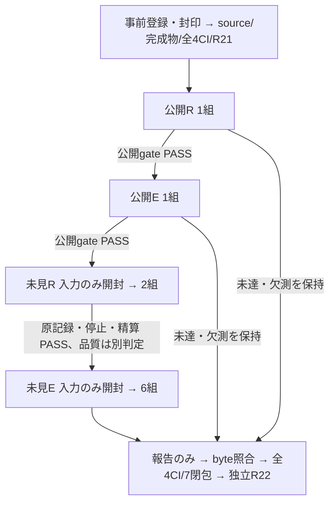

# 部品が揃った描画と、不足部品の補完を分けた評価

測定 head は `59ded276405a5dc9caa85ad570b1827ff4bd0c7a`。正しい部品と要求表を供給した未見2例は、全在庫 O・個数制約 Q ともに2/2で描けた。通常画面の補完方式 C は未見6例中4例で、不足2例は0/2だった。**部品が揃った条件の表現性能は有限範囲で確認できたが、不足すれば正しく補って描けるという製品性能は未達である。**

全4段階・20 planned / consumed / valid、INVALID0を保持した。[固定 index](evidence/index.json)、[独立した記録時点の集約](evidence/quota-cycle-recorded-aggregate.md)、各 phase の原 HTTP・選択・グラフ・保存・再描画・台帳を公開する。正式な CI 閉包は、この報告 head の全4 CI、実配布 artifact の双方による再計算、[Apps#103 の最新独立 review](https://github.com/roccho-dev/apps/pull/103) が一致した時だけ成立する。記録時点の集約にある「CI未確定」は当時の snapshot である。

## 結果と有限範囲

| 評価 | 原記録の結果 | 品質と効果の区別 |
| --- | --- | --- |
| 公開 R 1組 | O1/1、Q1/1、改善0、gate PASS | PUBLIC_REGRESSION_ONLY |
| 公開 E 1組 | B0/1、C1/1、適格な不足改善1、gate PASS | PUBLIC_REGRESSION_ONLY |
| 未見 R 2組 | O2/2、Q2/2、適格2組、改善0・回帰0 | 記録の品質基準 PASS。有限2例で quota 改善を観測せず |
| 未見 E 6組 | B3/6、C4/6。Cは充足2/2・不足0/2・対照2/2 | 品質 UNMET。適格な不足2組で改善0・回帰0・誤採用0 |

固定した CI 分類器が原記録・独立採点・実再描画を再計算して一致した場合の分類は、Rが `FINITE_CRITERIA_PASS / NO_EFFECT_IN_REGISTERED_EXPRESSION_PAIRS`、Eが `UNMET / NO_EFFECT_IN_REGISTERED_MISSING_PAIRS` となる。両方とも必要な実適格機会、描画・保存・期限・guard が揃った有限の改善ゼロであり、TypeLLM一般の無効性や未登録入力へ一般化しない。品質未達と、観測された改善ゼロと、一般性の未証明を分けて残す。

Rは同じ独立した完全在庫8個と正しい新規要求の名称・種類・個数を供給した条件付き native Goal / session.apply の比較である。構造の正解、親・矢印・座標は渡さない。完成UIの実描画・保存復元も照合したが、通常UIの要求解釈やTypeLLMの効果には数えない。未見例は別区画への1部品追加と、部品を増やさず既存API→DBを接続する依頼だった。

Eは通常画面のliteral-v2 Bとadaptive-v3 Cを同じquota条件で比較した。全6組を保持し、不足2組では両armの実提案適格性と同一literalを確認した。充足・対照はType0、全12セルの描画・保存・期限はPASS。QE01のB失敗→C成功はType0のG0 confidence .47→.59の判定差であり、TypeLLM改善へ数えない。

## 不足2例が止まった場所

| 例 | 要求された新規部品 | TypeLLM実出力 | 後続動作 |
| --- | --- | --- | --- |
| QE03 | 出荷可否 / decision / 1 | 判断 / decision / 1 | Vが不受理、最小confidence .02 |
| QE04 | API / step / 2 | 工程 / step / 2 | Vが不受理、最小confidence .08 |

両方ともHTTP200・構造validだが、明示された表示名を汎用名へ置き換えた。独立Vは正しく拒否し、preparations0・Goal judge0・graph unchangedだった。誤案を採用しなかったことと、要求を補完できなかったことを分ける。quota・Goal・rendererへ到達する前の抽出失敗であり、図の複雑さや描画速度による失敗ではない。[独立失敗分類](evidence/final-E/quota-final-E-failure-classification.json) と [原記録](evidence/final-E/raw/) を参照。

## 変更と合意した工程

今回の製品変更はcompletion.mjsの21行だけ。受理済みv2/v3のfull-NEW要求表があるとき、materialization後の既存部品を名称・種類の完全一致と要求個数まで、元の順番で絞る。B/C両方へ適用し、legacy receiptのない経路は従来どおり。部品名・キー・親子・矢印を生成せず、Goal/core6・renderer・G0/F/Vの質問、閾値、期限を変えない。候補枯渇は元のno-executable-deltaとして保存し、NONE合成や追加APIは行わない。

正式providerのcoreは [Ops#565](https://github.com/roccho-org/ops/pull/565) にあり、Appsが配布artifactを依存として利用する。Ops b4f611c、envs063e685、windows6aef693、UI756d47eを固定した。[envsとローカル起動](../typellm-poc-20261017/README.md#ローカル実行と-envs) の正規経路を利用し、鍵の実値は記録していない。

rootが実装・caller・CIを担当し、同じ独立subagent 1名が封印・正解・採点・監査・固定producerを担当した。

各実行前にactual PID/start/PGID/UID、source28、完成artifact、provider、preload、caps、入力hash、socket、GET原画面、鍵存在boolean、送信0を双方で束縛した。各phaseは一度だけ実行し、finallyでZも含む物理停止・厳密送信数・予約解除・同期logs・即時台帳を確認した。未見oracleは対応する停止・精算・全原記録確認後にだけ開封した。公開gateは同一headで通過し、実行開始後の製品・harness・採点・基準は固定した。未見Rの品質をEの採点へ置き換えない。

[独立R21](https://github.com/roccho-dev/apps/pull/103#pullrequestreview-5560532224) と [公開証拠allowlist](evidence/admission/pr103-59d-r21-artifacts.json) に実測入場を記録した。測定前に未使用export検査が比較callerを認識できず [b9 CI](https://github.com/roccho-dev/apps/actions/runs/39075574308) が失敗した。唯一のnamed evidence import/call/返り値使用と否定例を検査して59dedで修正し、静的14群・全4CIを通してから実送した。失敗を消したり未使用export検査を全体除外したりしていない。送信0の初回起動待ちとTLS警告も原stderrに残し、信頼設定や認証経路は変更していない。

実completed-ZIPのsynthetic機構試験はquota12セル/INVALID4保持/source28/原G0-F-V wire3組、旧frontier40セル/INVALID14保持/wire22組/境界60行を双方で検算した。旧6閉包・旧失敗・独立8 semantic modulesを保持し、新quotaを必須7番目の閉包として追加した。synthetic PASSをモデル品質へ数えない。

## 台帳と未証明

| phase | 実送Jev | 実送TypeLLM |
| --- | ---: | ---: |
| 公開R | 5 | 0 |
| 公開E | 5 | 1 |
| 未見R | 9 | 0 |
| 未見E | 20 | 2 |
| 今回計 | 39 | 3 |

累計charged **847J / 88T**、確認済み847/87。過去の不確定Type1を保持した。登録cap181/7、最悪累計989/92、全体各1000以内。phase cap16/0・19/1・32/0・114/6の未使用枠を自動で別用途へ移さない。setup・retry・correction・診断実呼出し0。全42所有PGIDがZを含め不在、予約0。最終即時cutoffは `1fb7f24d498e214a977bc557ba4b46c0d108ec34cb4f380a2a0de368445b2a80`。古い未使用封印poolは開封していない。

CI起点の実API実行はUNPROVEN、通貨費用はCOST_NOT_MEASURED。任意文の一般化、TypeLLM一般の有効・無効、4方式比較の完了、正式製品採用と期待性能の描画機構の完成は未証明・未達のままである。この工程の閉包を製品完成と扱わない。UI#362の明示的人間merge条件を保持し、自動mergeしない。

## 事前登録時点の設計記録

以下は実装前および実送前の記録である。当時のSEALED_NOT_ADMITTED、空index、808/85は履歴であり、現在の観測結果は上記と固定indexを参照する。

この記録は実装変更・実API呼び出しより前の事前登録である。同じ独立担当 R と工程・正解の封印・採点・停止条件を合意した。現段階は SEALED_NOT_ADMITTED / NOT_MEASURED。過去の失敗や判定を変更せず、公開例の成功を未見例の効果へ繰り上げない。

前回の測定は Apps 2cc4890b765a5534e92855f83f9232ae85bb373b、報告は 0aa3c4b90519a1c18c217753698806507ccff3c0。[独立 R20](https://github.com/roccho-dev/apps/pull/103#pullrequestreview-5560292063) と [apps#94](https://github.com/roccho-dev/apps/issues/94#issuecomment-6241893675) の判定は維持する。前回の品質・効果は未達、フロンティア拡大と無効性の確定は未証明である。

## 分ける性能

- R：必要な部品が独立に揃っているとき、文章から正しい親子関係・接続・個数を描写できるか。両方式へ同じ部品8個と正しい新規部品の名称・種類・個数だけを渡し、構造の正解は渡さない。
- E：必要部品が足りないとき、TypeLLM による補完が描画・保存まで改善するか。通常画面で literal-v2 B と adaptive-v3 C を比較する。充足例・不足例・曖昧／変更不要の例を別々に保持する。

R の O は通常の全在庫、Q は既存部品を必要数まで安定して絞る同一 Goal。R は正しい部品表を条件とした native Goal と session.apply の評価であり、通常 UI の解釈性能や TypeLLM の効果とは別である。完成した実 UI での名前付きカメラの描画・保存復元を、記録再生と CI で接続する。

変更対象の製品コードは completion.mjs の quotaGoalBundle と受理済み v2/v3 receipt 後の呼出しだけ。名称・種類・個数を完全一致で照合し、元の順番と一度限りのキーを保つ。部品の生成、親子関係や矢印の生成、要求の追加解釈は行わない。E の両方式にも同じ制約を適用する。部品候補の枯渇は既存の no-executable-delta として保存し、NONE の合成や追加 API 呼出しを行わない。

## 固定した工程

1. この公開登録を push し、認証済み読戻しと独立担当の確認を終えてから実装する。
2. 独立採点・監査、完成 Worker のキー不要比較、従来6閉包と新規 quota 閉包、4種類の実 CI、同一測定 head の source/runtime を検証する。
3. 各フェーズで実プロセスの送信ゼロを双方が確認してから一度だけ実行する。公開 R 1組 → 公開 E 1組 → 未見 R 2組 → 未見 E 6組の順。公開2ゲートは同一 head での通過が必要。
4. 各回の物理停止・予約解消・原ログ・即時台帳を独立照合してから、その回の正解を開封する。次の未見入力も段階ごとに公開する。
5. 採点と証拠の整合性を CI で再計算し、品質・効果・未証明を分けて報告する。実行開始後は測定コード・採点・基準を固定し、報告のみの変更はバイト照合と最終 head の CI で閉じる。

汎用の記録再生器は O/Q ファイル名を受け付ける最小の拡張を行う。O/Q を B/C へ別名化しない。既存6閉包・過去の入力・正解・原データ・採点基準は維持する。既存 smoke の終了理由の期待値は新しい既定動作へ必要最小限に合わせるが、実グラフ・呼出し数・元の終了理由の証拠は維持する。

## 判定と予算

未見 R は Q の2/2完全一致を品質条件とし、少なくとも1組の O失敗→Q成功と Q退行ゼロで、この有限条件の組み立て効果を認める。O の余計な追加を評価対象から除外しない。未見 E は品質6/6と、不足2組の実際の適格性・改善2/2・退行ゼロ・誤採用ゼロ・充足／対照ガードを別々に判定する。1改善を効果達成へ丸めない。

NO_EFFECT は全ての登録済み適格機会が有効に測定され、改善ゼロ・退行ゼロ・必要ガード成立の場合に限る。失敗は未達、欠測・無効・不適格な機会は未証明として保持する。一般的無効性は主張しない。CI 起点の実 API 実行と通貨費用は引き続き未証明である。

基準累積は Jev 808 / TypeLLM 85（確認済み808/84、過去の不確定Type1は課金枠に保持）。基準台帳 SHA-256 は ce6896e0b1eb7c3c749b659b36e3ed4467dc133042ace81dd990b9f2e10c28d4。今回の上限は181J/7T：公開R16/0、公開E19/1、未見R32/0、未見E114/6。最悪累積989J/92T。各1000回の全体上限を守り、残る11Jは未割当で自動消費しない。再試行・修正呼出し・診断呼出し・疎通呼出しは0。

完全な契約・入力・正解・封印検証・ハッシュは [公開 freeze](preregistered/quota-cycle-public-freeze.json)、[protocol](preregistered/quota-cycle-protocol.md)、[commitment](preregistered/quota-cycle-commitment.json) を参照。未見 payload、私有作成器、私有検証器はこの登録へ含めない。[index](evidence/index.json) は実行前の空状態である。

UI PR362 の明示的な人による merge 条件は保持し、今回のループでは merge しない。

## 実行前の図ID修正（v2）

独立担当の source-native 保存検証で、元登録の map_id quota-expression はアプリの正規 ID voice-graph と一致せず、正規 commitLog/restoreLog が foreign/rejected を返すことが判明した。root も公開3 fixture 全てで再現し、正規 ID では3/3の保存復元を確認した。元の protocol-only preflight は通常アプリの保存適格性を証明していなかった。

元の登録12ファイルと元の封印は保持し、[明示 addendum](preregistered/quota-cycle-prelive-map-addendum.v2.json) により別名 v2 を追加した。変更は各 fixture_contract.map_id と対応 oracle hash の結合だけで、文章・部品・要求個数・親子関係・矢印・順序・採点条件・予算は同じである。root は公開 R/E の値を逆変換し、上記3箇所以外が完全一致することを確認した。未見 payload は読んでいない。製品の identity gate は変更しない。

有効な登録は [freeze v2](preregistered/quota-cycle-public-freeze.v2.json) と [commitment v2](preregistered/quota-cycle-commitment.v2.json)。[独立 native 保存検証](preregistered/quota-cycle-map-identity-validation.v2.json) は実ブラウザー保存の証明を含まない。完成物の画面検証・4種類の実 CI・同一 head の独立受入は、引き続き実 API 呼出しの前に必須である。改訂時点の実 API 呼出し0、累積808J/85Tのまま。
