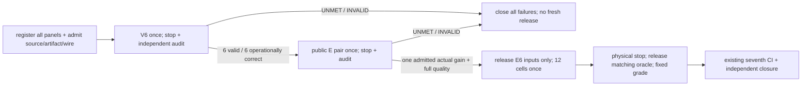

# compact-verifier-VE-20261018

Can this frozen verifier accept the exact requested NEW multiset and withhold wrong multisets, then let the unchanged Type completion path finish a missing diagram? The product intervention is limited to V completeness wording/context inside `requiredQuestion`; its wording is the writer's choice. F, G0, Goal, stock, quota, renderer, factor shapes, decision formula, confidence threshold .5 and deadlines retain their meanings. This registration does not compare old and new V live, so it cannot establish a question-only causal gain.

The previous public-only E remains closed at report9c83838bcbfa5c8a6e56eed6558d4fc287a5e300 / R26. Its correct API/step/2 proposal was followed by V `complete/.46` and an unknown hold, not a confident incomplete verdict. The old public gate was UNMET; its fresh E6 was not exposed or executed. No old result, criterion, seal or unused phase allowance is replaced here.

## Frozen stages and accounting

| Order | Phase | Panel | Maximum Jev / Type |
|---|---|---|---|
| 1 | compact-verifier-public-V-20261018 | public V6, verify only, fixed case order | 6 / 0 |
| 2 | compact-verifier-public-E-20261018 | known public E1, B then C | 19 / 1 |
| 3 | compact-verifier-final-E-20261018 | previously sealed/unexposed E6, fixed original BC/CB order | 114 / 6 |

Baseline charged850/137 (confirmed850/136; prior uncertain Type send remains charged), journal SHA90525733f94f161502411d957c953e1162850e7a1740f13cdad69a455e0d1478 at `quota-typed-public-E-20261018`. New allocation139J/7T; worst charged989/144 within1000 each. Eleven Jev calls remain unallocated. No setup sends, retry, correction, substitution or implicit transfer of old allowances. V is one verify POST / one Jev per case. E per pair is B G0+Goal<=9J, C G0+V+Goal<=10J and F<=1T (`GOAL_REQUEST_MAX=8`). Existing HTTP45s/check40s/Goal180s and provider limits remain fixed.

All three stages, public data, sealed hash/order/oracle, candidate source and both actual callers are fixed before the first V send. No source/question/grade/gate change after observing V. Only complete stopped/source/provider/accounting integrity and the preceding declared public quality gate allow progression. The operator runs each scheduled cell once and retains every failure and INVALID. Any incomplete record, cap/source/integrity or safety failure stops safely and remains UNPROVEN. Report-only documentation, raw-verifying tests and final CI may be added later while preserving the measured sources, ordinary payload and criteria by exact binding.

## Public V6 meaning

V input uses unchanged `voice-ui.requirements-cycle-input/1` and oracle `/1`, with direct `/api/parts/verify`, arm V and method verify. It has no extra parent fields. Every case uses only the already public TEP01 utterance/fixture/stock: two NEW API/step instances, not stock-adjusted quantities. The tables, in order, are exact API/step/2; wrong label 工程/step/2; wrong kind API/decision/2; wrong total API/step/1; API/step/2 plus extra DB/data/1; empty. All are legal bounded proposals. The oracle is one operational accept and five nonaccepts. These are five semantic errors, not malformed-contract tests. Oracle `required` always means the true full NEW set; `expected_missing` is the stock difference. Empty added-region/edge arrays mean this V panel authorizes no adoption; E graph targets are not inherited into V.

Reuse unchanged `gradeVerification` and public V6 summary: all six executions/contracts valid, all six accepted flags match expected_accept, false_acceptance0. This public operational gate requires the exact positive to be accepted at the unchanged .5 rule. Raw intent and completeness choice/confidence are recorded separately for every case. A negative nonaccept may be an unknown/low-confidence hold; it is not reported as a confident incomplete decision. Confident incomplete, low confidence and other intent blocks are separately counted. Static/synthetic grade selfchecks are not provider performance. V quality is finite public regression only; no ordinary UI completion or old/new causal gain follows from V6 PASS.

## Public E and held-out E6

Public E input/oracle are byte-for-byte aliases of the already public typed-ordinary-E TEP01, hashes52b95efd0dc3301c746b1d947e5896400bf7f12ee0e8d2d53113ddf8c2c08283 /837d68dd6c1da85ac3ce199d27dc88ceeb3ea57eff0ec18bdf5451ff6dd7124e. Their old internal semantic scope/IDs remain untouched; this new runtime profile is bound separately. Its pure literal baseline has valid=true, recognized=false, required=[], unsupported-syntax. That proves a parser deficit, not actual G0 eligibility.

E compares ordinary B literal-v2 and C adaptive-v3 with the existing thinking-labels F; both use quota. `generation=dependent` remains the DAG policy, not a new extraction name. G0/F/Goal/stock/renderer and B request meaning stay unchanged. The candidate V wording also affects C, so E measures the complete registered path; it is not a thinking-only or question-only mechanism claim. Canonical ordinary stages/receipts are not relabelled. Bind exact source, Worker, both formal provider entries/proofs and actual HTTP/stage/call/raw/paint/storage evidence. Keyless completed-Worker captures show intended wire differences and invariants; they do not claim to capture secret live upstream bodies or resolve the provider's latest model version.

After V6 PASS and stopped integrity, public E must have C whole-quality1/1, one admitted actual missing gain, both arms actually eligible and matching initial literal, B failed and raw unchanged, correct C proposal/minimal difference/V authorization, zero regression/false adoption, all guards and real paint/Apply/save/reload/deadline. Otherwise stop with fresh withheld. A public gain is PUBLIC_REGRESSION_ONLY.

The six-case E pool is the SAME prior seal, not newly authored: input4875B/f646112dbb14896a2e8f27d99f2b995e374aacf68b87058c7520e9821f420e43, oracle10052B/94ba803d5633ab9ddcbeedaedda3d04387255be27cadd93351fff6f68cbb08d7. Whole-byte identity preserves original cases, order, fixture, oracle and strata S2/M2/control2. Neither payload has been released to Root or run; no outcome was used to select or revise it. The new verifier V6 was authored from public TEP01 only. Old consumed D panels and older unused private pools are not reused. This is explicit preregistration for the first exposure/measurement under the new candidate; old commitments and original private files remain intact.

Only after the new public E gate and complete physical stop/integrity PASS may the unchanged E6 input be released; the oracle stays private until its own physical stop/reconcile. The caller never reads an oracle. Twelve original cells, including failures/INVALID, remain the quality denominator; there is no substitution or quality-based case selection. E uses unchanged quota input/oracle /1 and pure grades, null parent hashes and original BC/CB schedule.

Fresh whole quality requires C6/6. Finite completion effect additionally needs BOTH M2 actual eligible, matching literal, failed unchanged B versus correct C proposal/V/graph/paint/save, gains2, regressions0, false_adoption0 and all guards; S2 Type0/new candidates0 and control Type0/unchanged. Raw correct extraction, conditional native expression and CI success do not substitute for whole ordinary UI performance.

Registered finite missing-pair NO_EFFECT needs all12 valid, both M2 actually eligible/matching literal, gains0/regressions0/false adoption0, all S/control/paint/persistence/deadline guards and complete source/process/CI integrity. Unknown/ineligible/INVALID or an unmeasured pool never becomes NO_EFFECT. Quality UNMET and finite eligible-pair NO_EFFECT can coexist; TypeLLM general efficacy, arbitrary utterances and product completion remain unproved.

## Source, supply and closure

Use the existing requirements V caller/audits/grade and quota E caller/audits/grade, through the existing seventh quota verifier/artifact. V source inventory is its legacy17 plus `tests/quota-cycle-score.mjs`, which actually provides the closed repeat registry; E keeps its legacy28. Legacy V17/default profiles and every old grade/receipt retain their meanings. Each actual caller, source inventory and same candidate head is bound before first send. No eighth evaluation framework is added.

Formal Jev c7ed1132ad7bec8e5f05c6da38d719a05dec4877 and Type a724bdfa1864762cd9050a00e2642450af29c196 are separate producer identities; both complete locator/manifest/proof/provenance/entry bindings remain required. The existing normal envs FD route is used; keys and thinking text are never disclosed. Admission retains source/relevant CI/completed-artifact/wire checks, a single GET-only launch, actual same-PID/start/preload/caps/zero-sends and a separate one-shot measurement GO. Final closure requires actual required CI, stopped journal/provider reconciliation, original responses, fixed independent raw/binding/replay/process grades and current truthful PR bodies. Green integrity is not quality PASS. Apps remains draft; UI human merge permission is unaffected. ADR449/a6284e58ed99243447e135828d983fc07d2d363e: the small question, outcomes and boundaries are fixed; implementation choices belong to the writer.
