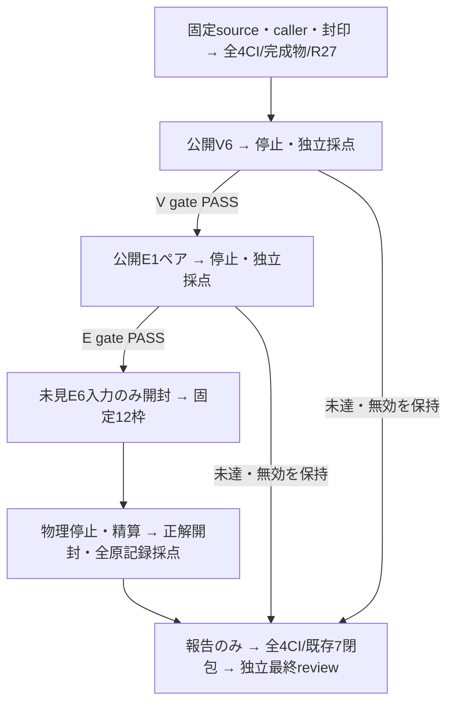

# 揃えば描き、不足すれば必要分だけ補う

問いは「原文から一意に決まる新規部品の表示名・種類・総個数と、この候補は過不足なく一致するか」です。
要求全体と在庫との差分を分け、部品が揃うときの表現性能と、不足を補う性能を別々に測りました。

測定 head は `180fc53e24f0fc2a5fdb098a3748afaff047bab6`、tree は `e2fc8ad6a1ccc3e83fa0cdc91e22434c5e02887c` です。
原記録と独立採点では、未見6例の比較対象Bが4/6、補完ありCが6/6。不足2例はB0/2からC2/2へ改善し、悪化・誤採用は0でした。
これは固定した有限6例の観測です。[固定 index](../evidence/verifier-repeat/index.json) に全3段階・20 planned/consumed/valid、INVALID0を保持しました。
正式な閉包は保存headの全4CI・実完成物・既存7閉包の再計算と、[Apps#103の最新独立review](https://github.com/roccho-dev/apps/pull/103) が一致した時に成立します。
原記録時点の `classificationBeforeCI: UNPROVEN` は当時のsnapshotとして変更しません。

## 分けて測った結果

| 能力・対照 | 原記録と独立採点 | 言える範囲 |
| --- | --- | --- |
| 部品集合の正誤判定：公開V6 | 6/6、正案1受理・誤案5非受理、誤受理0 | 公開6例の運用上の合格。旧新質問の因果比較ではない |
| 部品が揃う：未見S2 | B2/2・C2/2、Type0・生成候補0 | 通常画面での有限2例の表現性能 |
| 部品が足りない：未見M2 | B0/2・C2/2、適格な改善2・悪化0 | 新しい部品候補の補完が、図・描画・保存まで届いた有限2例 |
| 変更不要・未指定：未見対照2 | B2/2・C2/2、Type0・原図不変 | 不要な補完・誤採用0 |
| 公開E1ペア | B0/1・C1/1、適格な改善1 | 未見6例に合算しない公開回帰試験 |

V6の正案は `complete/.52` で受理されました。名前違いの誤案1例は `incomplete/.28` の低確信保留であり、不足の断定成功とは数えません。
他4誤案は `incomplete` かつconfidence >= .5でした。意図因子は6例とも `change` かつ >= .5、受理閾値.5は変更していません。

未見M2の「経路整形 / step / 2」「夜間照会 / decision / 1」は、名前・種類・総数と最小不足分が一致し、指定先への追加、実描画、Apply、保存・再読込まで通りました。
両方式の実提案適格性と初期literalの一致、全12セルの描画・保存・期限・guardを照合しました。
公開EではAPI/step/2を提案し、在庫との差分1つを補って、指定区画にAPI2つ・追加線0を作りました。

[前の独立供給R評価](../README.md)のO/Q各2/2は、正しい在庫と要求表を供給した条件付き評価です。今回の通常画面S2や補完M2の分母へ合算しません。
旧taxonomy8/10、4方式比較の未完、以前の不足失敗とNO_EFFECTの有限判定は再解釈しません。

## 最小の変更と合意した工程

製品変更はcompletenessの質問を短くする箇所だけです。候補と原文は既存stateへ置きます。
Fの9 scalar・3 label・thinking512、G0、因子・受理式・閾値、在庫差分、Goal/quota、renderer、期限は変えていません。
TypeLLM自身の改善や内部thinking機構を証明したとは扱いません。

[ADRs#449](https://github.com/roccho-dev/adrs/issues/449) と受理済み規範 `a6284e58ed99243447e135828d983fc07d2d363e` に従い、問う内容・成功条件・権限・予算・停止条件を固定しました。
Rootと同じ独立subagent 1名が、次の工程を合意して実行しました。

[入場R27](https://github.com/roccho-dev/apps/pull/103#pullrequestreview-5561717657) 後、各段階で一回GET-only起動、同PID/start・正規envs FD・両正式provider・source・caps・送信0を双方が確認してから、別の一回実送GOを受けました。
途中のsource・質問・caller・採点・条件の変更、setup・retry・correction・差し替えは0です。段階間の報告commit/CIは挟まず、同じ固定候補で進めました。
以前未露出・未実行だった同じE6原bytes・順序・正解を使用し、再作成・選択はありません。正解は対応する物理停止と精算の後にだけ解放しました。
最終的に全53所有PGIDがZを含め不在、予約0を双方で確認しました。

正式coreは [Ops#567](https://github.com/roccho-org/ops/pull/567) と [Ops#569](https://github.com/roccho-org/ops/pull/569) の配布物をAppsが依存として使います。
[envsによるsecret authoringとローカル起動](../../typellm-poc-20261017/README.md#ローカル実行と-envs) の正規経路を利用しました。鍵の実値は記録しません。

## 打開策と優先順位（主観）

| 打開策 | 現状・根拠 | 優先順位（主観） |
| --- | --- | --- |
| 実証済みの最小経路について、判定・補完の適用範囲を明示して正式採用を判断 | 有限PoCは原記録PASS。Appsはdraft、UIの人間merge条件はPENDING | 1：製品に届く次の判断 |
| CI起点の実API実行を証明 | 今回の実APIは正規ローカル起動。CIは停止済み記録の再検証 | 2：自律実行の未証明を解く |
| 充足判定・補完を、別の未見入力へ広げて評価 | S2/M2と公開V6を越える一般化は未証明。低確信保留も残る | 3：今回の有限成功を広げる |
| B単独の採用範囲を限定する | 今回のS2はType0で成功し、未見M2はB0/2 | 4：成功する有限範囲を明示 |
| thinking増量・複雑な表現の拡張 | 今回は既存512と既存描画で通った | 5：現時点で増やす根拠が弱い |

この順位は主観であり、測定結果や合格条件ではありません。TypeLLM改善そのものを目的にせず、最小構成で製品に届くことを優先します。

## 失敗と前回結果の保持

[前回の公開E](../typed-repeat/README.md) は、正しいAPI/step/2候補を既存Vの `complete/.46` が保留し、B/Cとも0/1でした。
[前回R26](https://github.com/roccho-dev/apps/pull/103#pullrequestreview-5561538864) はその保存・CI閉包のGREENであり、今回の成功へ書き換えません。
今回の公開Vに旧新対照はないため、質問変更だけの因果効果は未証明です。

測定前の [e3a80fa release CI](https://github.com/roccho-dev/apps/actions/runs/39100870657) は、旧来の「V質問文も原bytes一致」という検査で失敗しました。
登録したVのinstructions・complete/incompleteの3 scalarだけを固定文言へ置換して照合し、他のwire・F/G0・旧結果は維持しました。修正後180の全4CIと実完成物を確認してから実送しました。
最初のV起動直後のGET接続待ちは、[原stderr](../evidence/verifier-repeat/admission/V-initial-zero-readiness-failure.stderr.log) と記録を保持し、同PID・同helperの準備完了確認だけを行いました。別起動・追加予約・モデル送信はありません。

## 予算と未証明

| 段階 | 実送Jev | 実送TypeLLM |
| --- | ---: | ---: |
| 公開V6 | 6 | 0 |
| 公開E1ペア | 8 | 1 |
| 未見E6ペア | 32 | 2 |
| 今回計 | 46 | 3 |

開始850J/137Tから累計 **896J/140T**。Typeは確認済み139と、以前の不確定1を保守的に課金枠へ保持しています。
登録上限139J/7T・各1000以内で、未使用枠の移譲・追加消費はありません。最終即時台帳SHAは `98d12764f44e334291b1f9aa15152445e1abaef2466305a3d78405324c26b2fe` です。

原記録・独立raw gateの品質/効果PASSと、保存証拠のCI最終分類を分けます。
CIが原記録・producer・実配布物・再描画を再計算して一致した場合の未見E分類は `FINITE_CRITERIA_PASS / FINITE_SUPPLEMENTATION_EFFECT_DEMONSTRATED` です。
判定と採用の一般化、4方式比較の完了、CI起点の実API実行、内部thinking機構、通貨費用、正式製品採用は、この有限PoCの成功から確定しません。
Apps#103はdraftのまま、UI#362の明示的人間merge条件PENDINGを保持します。
