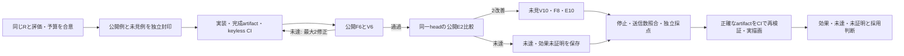

# 必要部品の判定・補完と描画を分ける反復

状態: 事前登録済み、実API評価前。前回の実測結果は [component axes](../component-axes-20261017/README.md) に固定している。

| 評価 | 与えるもの | 測るもの |
| --- | --- | --- |
| 表現 R | 正しい部品在庫と元の説明 | Goalが親子・接続を選び、実画面へ描き保存できるか |
| 検証 V | 元の説明と構造上合法な必要部品案 | 正しい案を受理し、意味上の欠落・余分・種類・数量誤りを拒否できるか |
| 補完 F | 元の説明、元の在庫 | 必要な新規部品の全量を提案できるか。在庫差分はアプリが計算する |
| 製品 E | 同一の説明・開始図・在庫 | 補完無効/有効を同じheadで比較し、完成図・描画・保存と補完による改善を分ける |

初回JevのG0は全段階で保持する。changeとincompleteの両方が既存の0.5基準を満たす時だけ、TypeLLMへ一度問い合わせる。TypeLLMは最大3個の新規部品全量を提案し、独立Jevが全量を再判定する。親・矢印・操作・IDは提案できない。受理後、アプリが一度だけ使える在庫を差し引き、不足候補だけを準備する。既存Workingのノードは追加用在庫に数えない。

必要部品が全部揃う自然文をTypeLLMが解釈した場合は、候補追加0と解釈費用を別に記録する。Bが正しく転記したのにG0が不完全と誤判定した費用も別に残す。TypeLLMを呼べたことや描画が表示されたことだけでは効果ありとしない。

プロセスと予算は [protocol](protocol.md)、独立封印は [commitment](preregistered/requirements-cycle-commitment.json)、封印時の元文書は [agreed plan](preregistered/agreed-plan.md)。次サイクル上限300Jev/40TypeLLM、開始時の課金上の累計689/40。過去の保守的な未送信Type1回分も差し引かない。

公開Eの後に意味を変える修正をした場合、旧headの成功pairを持ち越さない。修正枠では新headの両pairを再測定できない場合、未見Eを消費せず未達で閉じる。余った予算を自動的に追加しない。

通常の /api/parts/check は adaptive-v2。比較用 literal-v2 も同じWorkerの実HTTPを使い、初回G0をキャッシュしない。従来の literal/typed 経路と /complete の既定literalは履歴・互換用。新しいGoalは受理済みreceiptから候補を準備するので、二度目のTypeLLM呼出しや /complete はない。

opsの公開provider artifactをappsが利用する。今回の要件の意味・在庫差分・Goalへの受け渡しはappsが所有する。envsのsecret authoringと正規ローカル起動は [既存の起動文書](../typellm-poc-20261017/README.md#ローカル実行と-envs) を参照。APIキーをチャット・コード・ブラウザへ渡さず、既存のenvs復号経路でJEV_API_KEYとTYPELLM_API_KEYをプロセスへ注入する。新しい実行にも必ず残予算予約を先行させる。

CI起点での実API実行は別の性質で、現時点では未証明。CIは停止済みの実出力・送信記録・正確な配布物と、再描画を検証する。UI PRのmergeは既存の明示的人間承認条件に従う。

