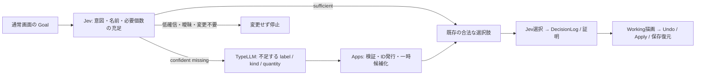
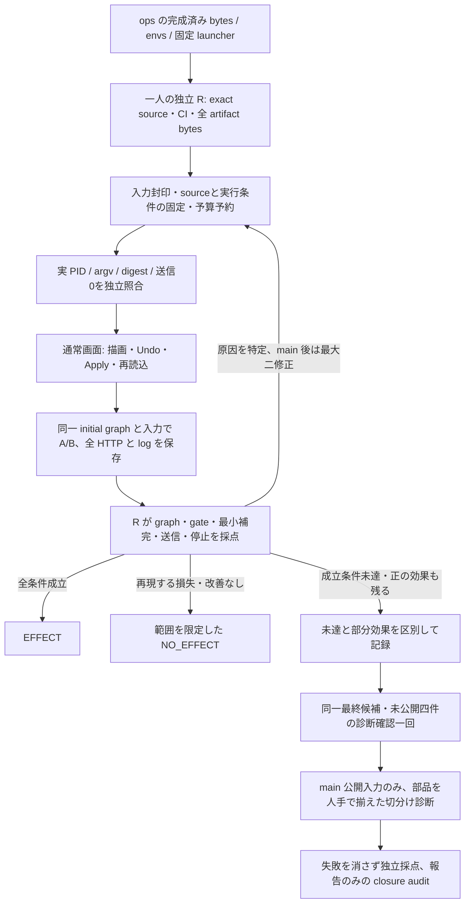
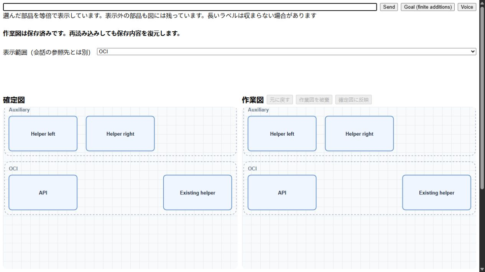

# 部品充足判定と TypeLLM 補完の PoC 検証

測定日は 2026-10-17 JST（記録の時刻は UTC）。実行者は `/root`、独立レビュー担当は継続して一人の `/root/poc_reviewer`。GitHub の投稿 principal は同じ `roccho-dev` であり、別アカウントによる承認とは扱わない。

**部品補完による部分的な改善は観測したが、合意した完成水準には到達していない。** 最終 main の不足ケースは、補完なし A の完全一致 0/4 に対して補完あり B が 2/4。両者が同じ missing 判定を受理した条件での改善である。一方、必要な種類をすべて返す補完と、通常画面の既知の新名称判定には失敗が残る。これを全面的な EFFECT や NO_EFFECT とは呼ばない。

envs に用意されたキーを使った正規のローカル起動・実 provider 疎通は成立した。しかし、`TYPELLM_API_KEY` を用意するだけで期待する描画品質になることは、この測定では実証できていない。

## 小さい完成形と実装範囲

期待する完成形は、既存の名前付き group 内で必要な部品の充足を判定し、揃っていれば選択し、不足時だけ生成で補い、同じ合法操作と証明経路で描く仕組みである。評価範囲は新規 region が最大三つ、directed flow が最大一本。同じ Goal で作った group 内への追加も含む。任意の複雑な文章、空の root からの組み立て、任意の operator、既存要素の移動・削除はこの PoC の成立証拠に含めない。



再利用する provider transport・型付き回答・CLI は [ops#561](https://github.com/roccho-org/ops/pull/561)。Apps は完成済み provider release の五つの digest と `named-choices-and-typed/1` を固定し、ops の source を build input にしない。graph の意味、数量の展開、配置、操作は Apps が所有する。恒久 library は八部品、一時候補だけ最大三 instance を足す。TypeLLM が parent・edge・operator・raw graph を生成して直接適用する経路はない。

Jev の一回の gate POST が三因子を返す。全因子の choice と有限の confidence を検証する。missing は実際に正の label/capacity witness がある場合のみ、その強い方を intent で上限づける。sufficient は三因子の最小値、その他の intent はその confidence を使う。既存の 0.5 floor と 180 秒の絶対 dispatch deadline は変更していない。合成の正しさは精度の保証ではなく、実測の正答とは別に検証した。

## 合意した工程と判定基準



main は初回出力の前に封印した十分四件・不足四件・control 二件。seal SHA256 は `22e47667ba3d6eaf1061c058b7f3e8fe07824dd3885b24264603a2be0b1f2c32`。A/B は同じ library・gate・合法選択 loop・initial graph/log bytes を使い、B だけが補完を許す。A は missing 時も未補完の候補で通常 loop を動かし、強制失敗させていない。AB/BA の順序も封印済み。provider と harness に渡すのは input-only projection であり、oracle を含まない。

main の EFFECT 条件は、受理された正しい gate が各 arm 9/10 以上かつ不足全四件正解、十分の完全一致 B が 3/4 以上で A から非悪化、不足の完全一致 B が 3/4 以上かつ A より二件以上改善、最小補完 3/4 以上、control 不変、十分/control への TypeLLM 呼出しゼロ。confidence が floor 未満なら、raw choice が正解でも gate 成功に数えない。

完全一致は label・kind・数量・parent・edge 方向、余分な semantic record の不在、既存 semantic fields の保持で判定する。ID と layout は oracle に使わない。全 DecisionLog と initial prefix は固定した本物の protocol で独立に検証する。疎通障害、契約違反、証明失敗、上限による停止を性能上の NO_EFFECT と数えない。

fresh 四件も main 出力前に封印した。seal SHA256 は `f92f733785ef8796eeed83c4880aa6481a32b4a8c2904a5292f5daaab6519fa2`。不足二件・十分一件・control 一件で、両 arm の gate 全件正解、B の不足二件が完全一致かつ最小で A より一件以上改善、十分非悪化、control 不変・十分/control Type ゼロが条件。最終 main と既知 UI の未達後、入力を開く前に、同じ候補で一回だけ最終診断を行うと R と合意した。fresh 成功で main/UI の失敗を上書きする変更ではない。

## 反復の全結果

| 候補 | 受理 gate A/B | 十分の完全一致 A/B | 不足の完全一致 A/B | B 最小補完 | 判定 |
| --- | --- | --- | --- | --- | --- |
| 初回 main `d0f7755` | 7/10・9/10 | 3/4・4/4 | 0/4・3/4 | 2/4 | VALID、EFFECT 未実証 |
| 修正一 `b2be591` | 9/10・9/10 | 4/4・4/4 | 0/4・0/4 | 0/4 | VALID_DIAGNOSTIC |
| 最終修正二 `e4a2af1` | 10/10・10/10 | 4/4・4/4 | 0/4・2/4 | 2/4 | VALID_DIAGNOSTIC、全体未達 |

全 round で十分/control の Type 呼出しはゼロ、control は各 arm 2/2 不変。初回の raw gate は全件正しいカテゴリだったが四件が低確信で停止した。初回 H05 の B は必要一個に二 instance を返し、図が正しくても最小補完に失敗した。H06/H08 は両 arm が missing を受理して B が正しくなった二件で、補完経路の正の効果がある。もう一件の gain は gate の受理状態も異なるので、補完だけの効果とは切り分けていない。

修正一では capacity と現在の graph を区別し、Type schema を occurrence 列から一意の label/kind と quantity 列へ変更した。重複・範囲外・総数過多を reject し、Apps が occurrence を展開する。しかし三つの実応答が空配列になった。失敗結果を捨てて成功語へ置き換えてはいない。

探索診断として、同一の公開 H07 context に旧 occurrence/min0・quantity/min0・quantity/min1 の三 schema を並べた一回の Type POST を事前合意した。結果は DB 三 instance・空配列・DB quantity2。これは表現と開始/停止の証拠であり、context の因果効果や品質 score には使わない。先行する一回は固定 CLI の build が TLS 検証で失敗し、decrypt/CLI/provider 前に終了した。この回も保守的に一回計上し、通常の CA を指定して exact dependency を prebuild 後、同じ payload を別 ID で一回だけ送った。

最終修正二では confident missing 後の schema を minItems1 とし、gate を三因子へ分けた。H05 の一つの新名称と H07 の同名 DB 三個は B が完全一致・最小補完を達成。H06 の異なる三 group、H08 の group 内の異なる工程/data では、Type が最初の group 一種類のみを返し、残る必要部品を補わなかった。main 二十件と既知 UI 二件の三因子の raw choice/confidence から gate 合成を再計算し、HTTP 応答と一致した。gate 合成のバグで図の失敗を説明することはできない。

fresh の最終診断も `VALID_DIAGNOSTIC / EFFECT_NOT_DEMONSTRATED`。受理 gate は両 arm 3/4、raw choice は 4/4。C02 の missing confidence が A0.40/B0.38 で停止した。十分は各 1/1 完全一致、control は各 1/1 不変、十分/control の Type はゼロ。不足は A0/2→B0/2、最小補完 B0/2 であり、main の正の効果は未公開の不足二件では再現しなかった。C03 は Type が中継室 group だけを返し、受付・受付控を欠いたため、後段が既存の工程・データで組み立てても期待 label と一致しない。

fresh 全十一 files（356,504 bytes）、八 HTTP 系列、同一 initial bytes、八 final logs と八 initial prefixes、八件の三因子合成を R が独立検証した。phase7 は 36 Jev/1 Type。2026-10-16 17:08:34Z に PID/PGID103224/start7802310 の全 member（zombie 含む）の不在と reconcile を独立確認し、その後に初めて fresh oracle の公開を許可した。後から公開した oracle を provider 入力に使った測定ではない。

## 人手で部品を揃えた追加の切分け診断

main/fresh の採点・停止を終えて両 oracle を公開した後、公開 main H06/H08 だけを使う別の診断を合意した。これは観測後に追加した oracle-assisted inventory-ready 条件であり、未公開評価、TypeLLM 補完の成功、主 score や full EFFECT の成立に加算しない。過去の R 報告の「測定終了」は、その時点での main/fresh 測定終了を表す。元の報告は書き換えていない。

同じ e4 source/Worker、同じ文章と initial graph/log bytes を使い、canonical 八部品の step/data/group の三 slot だけを置換する。H06 は読込班・点検班・保管班の group 三つ、H08 は検品室 group・寸法測定 step・測定票 data。他五 slot はそのまま、purpose は `one {kind} part named {label}` のみで parent/edge/解法は教えない。既存 `readBundle` で検証し、実 Jev gate を省略・強制せず、completion:false で既存 legal/proof loop を各一回動かす。合計上限は18 Jev、Type0。

fixture SHA256 `2091b8180120d27a62098a94c98c536a3f5feed5b4a609353482abdc9b9b8b30`、別 driver SHA256 `19c3ca58958cefb19b10b9df6a6db565c1c592111ea7e59b6ce6cb096103dc79`。元 production source と paired harness は変更していない。R が出力前に固定した合否は、各 case の accepted sufficient と元 main oracle に対する exact graph を別々に判定するもの。失敗も含め一回の結果を保存する。

独立採点は `VALID_ORACLE_ASSISTED_DIAGNOSTIC`。H06 は sufficient0.91 / 8 Jev、H08 は sufficient0.88 / 9 Jev で、どちらも受理 sufficient と完全一致の両方を達成した。H06 は同階層 group 三つ、H08 は新 group 内の step/data と正方向 edge を組み立て、既存 semantic fields を保持した。Type 呼出しはゼロ。全五 raw files（168,666 bytes）、library の三 slot だけの変更、二件の三因子合成、二 final と二 initial prefix を R が検証した。17:22:47Z に PID/PGID103655/start7896006 の全 member（zombie 含む）の不在と17/0精算を独立確認した。

この結果は「手で正しい八 slot 在庫を与えたこの二件は組立可能」を支持する。実際の Type 完全補完後の十一候補 overlay とは候補数・keys・purpose も異なるため、取りこぼしだけが唯一の原因だと断定はできない。Type の品質成功や fresh の代わりに数えることはできず、全体の EFFECT 未達は変わらない。

## 通常画面と表示上の制約

最終 e4 の新しい localhost origin は保存済み図ゼロから、通常の「新しい図」→既存の Container preparation を Send→Apply と操作した。同じ既知の「洗浄をひとつ OCI に追加」は intent change0.97 / labels available0.38 / capacity within0.98 となり、sufficient0.38 で停止した。Type 呼出しゼロ、Working SVG は baseline と完全一致。補完側が描けていないので、この候補での missing Undo は未実施である。

既存 API 一つの Goal は sufficient0.80 で成功し、OCI 内に一個だけ追加した。gate 一回と合法選択三回、全四 HTTP200 request/response を欠落なく保存した。Apply の Working/Confirmed、再読込後の同じ正式 OCI camera の Working/Confirmed は raw SVG SHA256 `2f593d6869884f127d9a214e440acf3208316417a6f044359516512f914a7a18` で一致する。復元処理中の最初の camera 選択が反映されなかった capture も保持し、通常操作で全体→OCI を選び直して完了後に照合した。



旧 d0 では missing の描画→Undo→再描画→Apply→復元を観測したが、最終 e4 の missing 成立証拠へ流用しない。旧 d0 の最初の UI wire と十分 UI の inventory HTTP は観測 buffer から欠落し、その制約を保存している。計画した missing 再測定の五 HTTP と全 paired main は完全に収集できた。縮小した概要表示の group 見出し重なりは未解決であり、OCI camera で読めることを任意の図の美しさと同一視しない。マイク入力と正式公開物を用いた live acceptance は今回の証明対象ではない。

## 測定 tuple と証拠

| 対象 | 固定値 |
| --- | --- |
| Apps head / tree | `e4a2af1efe9278996391f0374d4546a51aa98736` / `838f9fe0f3df36c344aaf55d353481adbbba01ca` |
| Ops completed source | `cab432ef717cbde9ebd0197ae006c0efe75269bf` |
| Windows launcher source | `6aef693c0946903d8b87c2348039de1420acd61b` |
| Envs ciphertext source | `063e685b8b21a97fc8658879da93fa858552bcd6` |
| Worker SHA256 | `cfc3baca20a2ede70504610e84046c1a32894160c50f2ceae20835ef69d4e00b` |
| Provider entry SHA256 | `ad4ac08ae8c42f3bf0e9d0aeedb0a2e9192c776585a3251b2ff1e18358cfe2e7` |
| Semantic protocol SHA256 | `1689dcf63e1ed19cdea7be22e3f90a09f434841f980b9ca8b9018a987c9c38f8` |
| Completed manifest SHA256 | `c9555664c2bb936841b34ba61bfacef971e0b2ae76d5e880cc0d00b5bf08c395` |
| Main input projection SHA256 | `83f6c7ec8c5bf904afdcafbe2f88a272897606288088e665b71e26f1eea84c1c` |

同じ R が all290 manifest files（91,244,129 bytes）を独立照合し、source→dist の browser/core/UI/server bytes、実 PID・start ticks・argv・provider/protocol/launcher/preload を確認した。[e4 full CI](https://github.com/roccho-dev/apps/actions/runs/38934284716)、[exact-head source/completed-byte review](https://github.com/roccho-dev/apps/pull/99#pullrequestreview-5550977800)。source の Green は性能の Green とは区別する。

`evidence/*.evidence.json.gz` は gzip で包んだ `voice-ui.poc.evidence-archive/1` JSON。一件ごとの name・sha256・bytes_base64 を保持している。main の各 archive は identity/execution/events と二十 arm の計二十三 raw files。現在の動作に合わせて過去の raw 証拠を書き換えていない。独立採点・取得/停止照合・protocol/factor audit、測定 tuple、探索診断の payload/result と組み合わせて検算できる。

| Archive | SHA256 |
| --- | --- |
| 初回 main | `2196eff29a8b3b94bdd1f5ccb737d1c0ce7d32561a88c8386f4985c021d015d7` |
| 修正一 main | `bde71cebb8b8308f2dc6499fbc9d250c1f45e4b2654290665b034fb5eb2634ce` |
| 最終 main | `4d6445462d1227399e15a847f886c122afca7a678eb810e525ea7bb123d9903f` |
| 通常画面の全履歴 | `f32f42ad7956c5380edd4e429ca38c339d92058f6217d82eb11790e723efd3ac` |
| 最終 fresh 診断 | `ae28f2c179feee80301bbb35e99d6c03391068c6ee4024250f09088a6fe2a651` |
| 実行と予算履歴（phase7まで） | `5867567d66b4d474b1b405510fd0b908d083b809229521d22676c2b2c23b3c91` |
| 人手で部品を揃えた切分け診断 | `cbb632536abc0e0234b68edf6978ebd130952b6fcc820c8a5aad3269cf73f28f` |
| 実行と予算履歴（phase8まで） | `a0a450b65ebc1b1240de881bf856c62e84de5871e8f0f2d442353f2ecae1c5f5` |

phase7 停止・照合時の累計計上は Jev275/300、TypeLLM18/300。後から合意した切分け診断の phase8 は17 Jev/0 Type で停止・精算し、run manager の最終累計計上は **Jev292/300、TypeLLM18/300**。差の Type 一回は前述の provider 前の build 失敗を保守的に残したもの。上限超過・自動 retry・未照合の予約はない。phase6 は通常画面 6/0 と main84/4 の計90/4、phase7 は36/1だった。これ以前の疎通・HTTP400・低確信停止・探索診断も runtime archive の連続した journal に残す。

独立に確認できた実送信は最終292/17。すべての予約を停止後に照合し、phase8 を含め active な app process は残っていない。残り八 Jev 回を、新しい比較全体の成立証拠や無計画な成功探索のためには使っていない。

`node docs/voice-ui/typellm-poc-20261017/verify-evidence.mjs` は外部通信せず、index と全 archive member の raw digest を検算する。これは semantic 採点の再実行ではない。元の独立 scorers は repo 直下の `review-evidence` を基準とする。過去 round を再採点する際は、その round の exact Apps source を別 worktree に用意し、対応 raw archive を `review-evidence/paired-main-d0f7`、`paired-main-b2be`、`paired-main-e4a2` または `paired-confirmation-e4a2` に復元し、同じ `review-evidence` へ公開済み seal/projection と元 scorer/audit files を原 bytes で置く。protocol の byte 同一性も確認する。docs の中から元 scorer がそのまま動くとは扱わない。新たな provider 呼出しは採点の replay に必要ない。

## ローカル実行と envs

`TYPELLM_API_KEY` は既存 Jev key と同じ own target の envs ciphertext に設定済み。[envs#106](https://github.com/roccho-org/envs/pull/106)、[windows#99](https://github.com/roccho-dev/windows/pull/99) は merge/canonical CI 済み。キー本体を checkout・ブラウザ・引数・ログへ渡す必要はない。

実行場所は Windows から SSH する `g6i3-own` 上の通常ディレクトリ。Nix store 内から起動しない。まず固定した Apps を通常の認証/CA 設定で prebuild する。今回、閉じた launcher 内で dependency の HEAD 取得が CA エラーになったため、通常環境に設定済みの CA bundle を Git にも指定した。証明書検証を無効にはしない。

```sh
cd /work/repos
export GIT_SSL_CAINFO="${NIX_SSL_CERT_FILE:-${SSL_CERT_FILE:?CA bundle is required}}"
APPS_REF='git+https://github.com/roccho-dev/apps?rev=e4a2af1efe9278996391f0374d4546a51aa98736&allRefs=1'
DEV_DRV=$(nix eval --raw "$APPS_REF#apps.x86_64-linux.dev.program" \
  --apply 'p: let c = builtins.attrNames (builtins.getContext p); in if builtins.length c == 1 then builtins.head c else throw "not one derivation"')
nix build --no-link "${DEV_DRV}^*"
nix build --impure --no-link --print-out-paths --expr '
  let s = builtins.getFlake "git+https://github.com/roccho-dev/windows?rev=6aef693c0946903d8b87c2348039de1420acd61b";
      p = import s.inputs.nixpkgs { system = "x86_64-linux"; };
  in (import (s.outPath + "/oci/dev/nix.nix") { pkgs = p; }).jev.typedLaunch'
```

完成した `voice-ui-typed-dev` を、run 全体の残予算から予約した allowance で起動する。プロセスを再起動しても run 全体の累計をリセットしない。今回の実行では、保存した run manager が fsync した予約を先に作り、送信前の journal と停止後の照合を行った。

```sh
/nix/store/<built-launcher>/bin/voice-ui-typed-dev \
  --envs-sha 063e685b8b21a97fc8658879da93fa858552bcd6 \
  --apps-sha e4a2af1efe9278996391f0374d4546a51aa98736 \
  --port 18845 --jev-limit <RESERVED_JEV_CALLS> --typellm-limit <RESERVED_TYPELLM_CALLS>
```

launcher は exact Apps の build を decrypt より先に行い、UID/permission・ciphertext field・単一 recipient を検証して FD3/4 で一つの閉じた child に渡す。global profile は変更しない。固定 preload は二つの provider POST endpoint に限り、redirect/自動 retry を行わず、fetch 前に送信を記録する。Windows の未使用 loopback port を own の `127.0.0.1:18845` に SSH forward し、ブラウザで開く。「新しい図」→既存の Container preparation を Send→Apply が、評価済みの準備経路である。

## 関連する議論と公開物

既存の議論は [apps#94](https://github.com/roccho-dev/apps/issues/94)、[apps#58](https://github.com/roccho-dev/apps/issues/58)、[adrs#496](https://github.com/roccho-dev/adrs/issues/496)、[adrs#497](https://github.com/roccho-dev/adrs/issues/497)、[adrs#520](https://github.com/roccho-dev/adrs/issues/520)、[adrs#635](https://github.com/roccho-dev/adrs/issues/635)。実装 PR は [ops#560](https://github.com/roccho-org/ops/pull/560)、[ops#561](https://github.com/roccho-org/ops/pull/561)、[windows#99](https://github.com/roccho-dev/windows/pull/99)、[apps#99](https://github.com/roccho-dev/apps/pull/99)、secret authoring は envs#105/#106。ops は normal merge→canonical CI→publish/readback 済みで、Apps がその完成済み bytes に依存する。

報告追加はこの docs と root README のみに限定する。同じ R が許可した差分・full CI・normal merge の同一 tree・canonical CI・release readback と普通の実行 closure の raw 一致を検査する。個別に列挙した commit/provenance identity、architecture source commit と対応 digest、同じ target bytes を指す launcher store path だけが差分候補である。実行 bytes が変われば測定を流用しない。後の正式公開物そのものを live API で測定したと主張しない。
