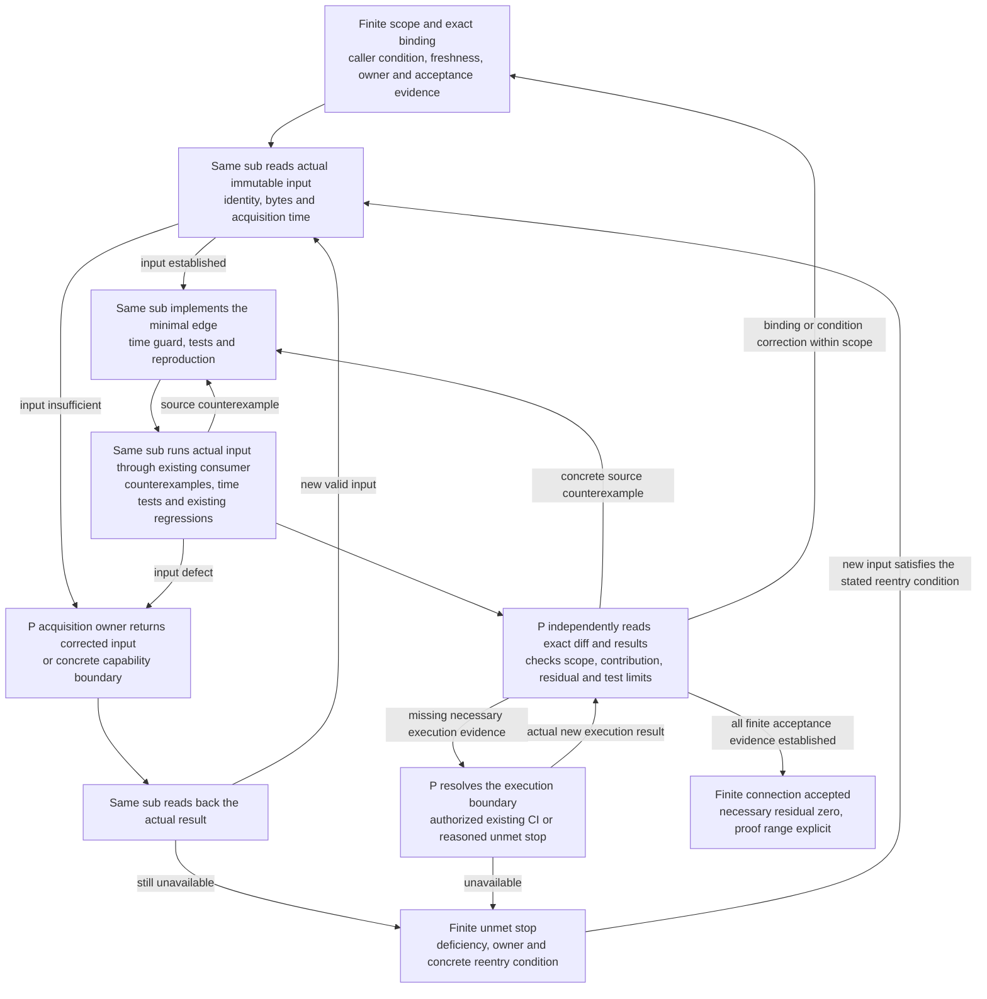

# Atlas G — read-only collection

G collects; it does not judge. Output is JSONL of two event kinds, `observation` and
`plan.set`. Satisfied / unmet is decided by D, not here. Anything a snapshot does not
literally carry is the string `UNKNOWN`; nothing is inferred and nothing is typed by hand.

```
fetch.mjs (gh api / ssh / tcp, read-only)  →  snapshots/*.json  →  adapter.mjs  →  collect.mjs (pure)  →  events.jsonl
```

| File | Role |
|---|---|
| `fetch.mjs` | Acquisition only. Runs `gh api` (existing login), the existing `ssh`, TCP probes; stores the raw responses / stdout. |
| `adapter.mjs` | The only place that knows data formats: gh JSON paths, `--slurp` pages, process/file listing lines. Snapshot → normalized record (`thread`, `pr`, `sessions`, `ports`, `fact`); missing → null. |
| `collect.mjs` | `collect(records, recordedAt)` → events. CLI reads a snapshot dir through the adapter. No network. |
| `plan.mjs` | Marker sections in text → `plan.set` (mermaid flowchart + exit table). |
| `journal.mjs` | ```` ```jsonl ```` in marker sections and declaration files → journal decisions (actor = author). |
| `observe.mjs` | Normalized PR / session / port values and facts (`{target, value}`) → `observation`. |

## Run on G6I3 (P)

PowerShell, from the apps checkout, with gh already authenticated and `ssh g6i3-own` working:

```powershell
Copy-Item packages/atlas/collect/collect.config.example.json $env:TEMP/atlas-collect.json
# edit $env:TEMP/atlas-collect.json: fill the declared session ids (and ports) — this is the only declaration
node packages/atlas/collect/fetch.mjs $env:TEMP/atlas-collect.json .artifacts/g-snapshots
node packages/atlas/collect/collect.mjs .artifacts/g-snapshots --out .artifacts/g-events.jsonl
```

`fetch.mjs` calls, per entry (all GET / read-only GraphQL):

- `gh api repos/<owner>/<repo>/issues/<n>` — body and `updated_at` (Issues and PRs)
- `gh api --paginate --slurp repos/<owner>/<repo>/issues/<n>/comments?per_page=100`
- PRs only: `gh api graphql` → `state merged mergedAt headRefOid commits(last:1){oid statusCheckRollup{state}}`
- `repos: [owner/repo]`: `gh api repos/<owner>/<repo>` — `archived`
- `issueStates: [owner/repo#n]`: `gh api repos/<owner>/<repo>/issues/<n>` — `state`, `state_reason`
- sessions: `ssh g6i3-own 'ps -eo pid=,args='` and `ssh g6i3-own 'find ~/.claude/projects -name "*.jsonl"'`
  (override with `sessions.processCommand` / `sessions.filesCommand` in the config)
- a host without `ps` (e.g. g6i3-own): read `/proc` instead; the output keeps the `<pid> <command line>` form

  ```json
  "processCommand": "for p in /proc/[0-9]*; do c=$(tr '\\0' ' ' < $p/cmdline 2>/dev/null); [ -n \"$c\" ] && printf '%s %s\\n' \"${p#/proc/}\" \"$c\"; done"
  ```
- ports: a TCP connect to each declared `host:port` (2 s timeout)

gh responses are stored as returned (`data`) and session listings as raw stdout; a failed call is
stored as null, which the transform turns into `UNKNOWN`. Snapshots from before the adapter
(sessions stored as parsed arrays) read as `UNKNOWN`; rerun `fetch.mjs`.
`--recorded-at <ISO>` pins `recordedAt` (default: now).

## observation

`{kind:'observation', target, value, source:{ref, sha256}, observedAt, recordedAt}`

Every GitHub id carries its owner (adrs#647 v9): targets `owner/repo#n:<fact>` and `owner/repo:archived`,
plan ids `owner/repo#n:<slug>`, plan node ids `owner/repo#n:<node>`, plan `source.repo` and journal
`source.ref` `owner/repo#n`. A fork and its upstream (`roccho-dev/Meltype#26`, `yksr-melt/Meltype#842`)
never share an id. Only `adapter.mjs` qualifies; a snapshot without a plain owner and repo name is
refused. Declarations naming the old owner-less ids no longer match (no fallback by name).

| target | value |
|---|---|
| `<owner>/<repo>#<n>:pr.state` | GraphQL `state` (`OPEN` / `CLOSED` / `MERGED`) |
| `<owner>/<repo>#<n>:pr.merged` | `"true"` / `"false"` |
| `<owner>/<repo>#<n>:pr.head` | head SHA |
| `<owner>/<repo>#<n>:ci.rollup` | GitHub's `statusCheckRollup.state` of the head commit; null or other commit → `UNKNOWN` |
| `<target>:session` | `running` / `transcript-only` / `not-found` / `UNKNOWN` |
| `<target>:port` | `responding` / `no-response` / `UNKNOWN` |
| `<owner>/<repo>#<n>:plan.source` | only when the Issue/comments fetch failed: `UNKNOWN` (not "no plan") |
| `<owner>/<repo>:archived` | `"true"` / `"false"`; a non-boolean or missing field, or a failed call → `UNKNOWN` |
| `<owner>/<repo>#<n>:issue.state` | `state`, plus `/<state_reason>` when GitHub gives one: `open`, `closed`, `closed/completed`, `closed/not_planned`, `open/reopened`; no string `state` → `UNKNOWN`; a PR (`pull_request` key) → `UNKNOWN`, reason in `source.ref` (list PRs in `pulls`: `pr.state`, `pr.merged`) |

`observedAt` is normally the snapshot's fetch time. The retained Gov report edge below keeps
the artifact's original time instead. `observedAt > recordedAt` is rejected (throws).

G emits fact targets only (`roccho-dev/windows:archived`, `roccho-dev/apps#92:pr.merged`). It never writes a meaning target
such as `input:semcmp-adopted`; which fact satisfies a condition is P's declared predicate. Keeping
`state_reason` inside the `issue.state` value lets one `equals "closed/completed"` predicate exclude
a reason-less or `not_planned` close, and keeps an open issue's null reason from becoming `UNKNOWN`.

### Retained Governance contract reports → the same observation port

`type: "governance-contract"` is a file-input edge for the existing finite Apps member/final
report family. It uses the same `fact → observation → joinLog → deriveAtlas → contractWorld`
path; there is no second comparator, ledger, semantic authority, acquisition service or timer.
It does not fetch, run a build, publish a release, or admit raw ADRS. The input bytes and provider
metadata must come from the authorized authenticated acquisition; local hashes establish
coherence and traceability, not source authenticity by themselves.

The caller supplies `owner`, `repo`, `binding`, `provider`, `fetchedAt`, and `responses`:

- `binding` selects the exact target/Gov repositories and candidates, obligation, claim ceiling,
  accepted Requirement `{repository, revision, path, digest}`, projected `requirementDigest`,
  and canonical `meaningDigest`. It is a selection of existing accepted evidence, not a new
  admission step. Raw source bytes, canonical meaning and the projected obligation have different digests.
- `provider` preserves the artifact id, run/head, original `artifact.created_at` and `retrievedAt`.
  The artifact creation time is the observation time of the retained report, not the build time
  or proof that the live application is currently healthy. `fetchedAt` must equal `retrievedAt`.
- Each response has `{text, sha256}` for the original UTF-8 bytes: `member` (member.v3), `package`
  (package.v1), `gate` (gate.v8), `input` (contractDiffInput.v1), `meaning` (the single raw ADRS row),
  and `manifest` (the existing bundle-manifest array). No values are filled from filenames or memory.

The edge checks the original hashes, member digest, embedded member/final equality, existing
manifest binding of input/meaning bytes, and their exact identity against the selected binding.
It does **not** rerun Receipt/comparator proofs or reinterpret their pass flags. A coherently bound
`contractDiffStatus` / exit pair stays literal: `CLOSED/0`, `OPEN/2`, `INVALID/3`, `UNKNOWN/4`.
Missing bytes, wrong identity, incoherent hashes or unsupported shapes emit an `UNKNOWN` fact;
a missing exact selection or original timestamp fails explicitly. These format checks do not
make a report authoritative. The upstream 4-state checker and its admission boundary are unchanged.

The fact target is
`<owner>/<repo>@<targetCandidate>:contract:<obligation>:<raw-source-digest>:<GovCandidate>:contractDiffStatus`.
The source reference retains the selected Requirement locator, provider run/artifact, fetch time
and failure reason, with a digest of the binding, metadata and response hashes.
`availableAt=fetchedAt` stays on the normalized fact only; `collect` refuses a `recordedAt` earlier
than acquisition. Thus an old report can enter the journal today while retaining its old
`observedAt`; acquiring it again does not renew freshness or create knowledge in a past frame.

The caller separately declares the finite Purpose/Ideal/Norm using existing Atlas events. This
edge emits no `purpose.set`, `ideal.set`, `purpose.evaluated`, `matched` or business verdict.
`matched` means only that the caller's explicit observation conditions are satisfied within
their declared freshness. Contract CLOSED, Ideal matched and a human `achieved` evaluation remain
different states. Source decisions and accepted meaning are references, not invented authors of
the caller's new declaration.

#### Finite execution and failure returns



The sub implements and runs this slice; P owns its independent acceptance. A source defect returns
to the same sub, an acquisition defect to P as acquisition owner, and missing meaning/admission
to its existing meaning owner through P. UNKNOWN is an expected observable residual in negative
tests, not acceptance of a broken positive input. A corrected input/time or a new execution result
must be read back before reentry; rephrasing the same failure creates no loop. The Windows regression
setup failure at `tests/closure.test.mjs` (`symlinkSync` EPERM) is an execution limitation, not a source
fix or an all-regression PASS. Necessary execution evidence stays open until the existing authorized
CI result or a concrete scope decision is available. Commit/push/PR requires P's separate permission
after diff review; no such publication, merge, adoption, Factory operation or Gov/Ops modification
is authorized by this diagram. Finite connection acceptance is not the parent Purpose verdict.

#### Reproduce with the retained contract-632 input

Normal CI already runs `packages/atlas/tests/*.test.mjs`, including
`governance-contract.test.mjs`. Its synthetic shape fixtures test the format and temporal
boundaries; they are not actual Gov negative-test evidence or human evaluations. No fixture ZIP
is committed. An additional explicit input test reads the same retained immutable raw artifact:

```powershell
$env:ATLAS_CONTRACT_INPUT = (Resolve-Path .artifacts/contract-632-input).Path
$env:ATLAS_CONTRACT_OUT = "$PWD/.artifacts/contract-atlas-edge-result"
node --test packages/atlas/tests/governance-contract.test.mjs
Remove-Item Env:ATLAS_CONTRACT_INPUT
Remove-Item Env:ATLAS_CONTRACT_OUT
```

Input directory: `artifact.zip`, `provider-metadata.json`, and its original `body/` tree. This
finite run selects Apps `71409fa013b6cb681c0a80b4c377e4685685b690`, Gov
`3b9246ff1b4bb0211508213ac714ab460f3801dc`, obligation `apps.voice-ui-artifact-auth.v1`,
ADRS `862313008ad19a743034599792d9a8b6e470e4cf`, artifact `12094315572` / run `39013346081`.
The ZIP is 125160357 bytes, SHA-256
`b9a0400e6fcbc6de2d47c367553e5752e7b2a82f6fa7a2f9fa1d905a955c326c`.
Meaning acceptance is [the existing T2 readback](https://github.com/roccho-dev/adrs/issues/632#issuecomment-6192556296);
the prior finite result is [the same-version W/R/P synthesis](https://github.com/roccho-dev/adrs/issues/632#issuecomment-6231891936).
Neither is relabeled as the caller of this test's Purpose/Ideal.

Outputs are the generated `snapshot.json`, `events.jsonl`, `before.json`, `selected.json`,
and `current.json`. The explicit caller condition uses a two-day freshness to demonstrate the
connection at acquisition time. The same report with a one-hour condition remains stale with
one residual. `before_ideal=1` exposes that the report already existed before this caller's Ideal.
The contribution is the previously missing evidence connection: with the same Ideal, absent
observation is unknown and the acquired exact observation can satisfy it. This does not recreate
the old build or claim that this code newly improved its runtime, achieved the parent business
Purpose, or made the existing finite Gov/Apps proof incomplete.

The selected two-day window is a caller test parameter, not a new accepted domain freshness
policy. Purpose/Ideal suitability and human Purpose evaluation remain with their existing owners.
For wider tracking, ref/rel existing [ADRS#632](https://github.com/roccho-dev/adrs/issues/632),
[Atlas#647](https://github.com/roccho-dev/adrs/issues/647),
[Apps#95](https://github.com/roccho-dev/apps/issues/95),
[Ops#524](https://github.com/roccho-org/ops/issues/524) and
[Gov#215](https://github.com/roccho-dev/governance/issues/215); their wider adoption/continuation
requirements are not replaced by this observation edge.

### Session rule

Only the declared `sessionId` per target and the two captured lists are evidence:

1. a process command line contains the session id → `running`
2. else a session file path contains the session id → `transcript-only` (a past transcript exists; not activity)
3. else, both lists captured → `not-found`
4. a list needed for the step above was not captured, or no id declared → `UNKNOWN`

Target names, process names and file names are never matched against the target.

## plan.set

Only sections that start at a marker `<!-- <slug>-v<N> -->` in an Issue/PR body or comment
are read; a section runs to the next marker or the end of that text. Per `<owner>/<repo>#<n>:<slug>`
the highest `N` is current. Two different texts with the same highest `N` → nodes/edges/exits
`UNKNOWN`, `unknown:['conflicting-version']` (no winner).

```
{kind:'plan.set', plan:'roccho-dev/resources#25:windows-retirement-migration-20261016', version, recordedAt,
 source:{repo:'roccho-dev/resources#25', commentId|null, updatedAt, sha256},   // sha256 of the extracted section text
 nodes:[{id:'roccho-dev/resources#25:E', label, shape, groups, exit, predicate, owner, requires}] | 'UNKNOWN',
 edges:[{from, to, kind, condition, style}] | 'UNKNOWN',
 exits:[{node, exit, predicate, owner, requires}] | 'UNKNOWN',
 unknown:[...reasons], unparsed?:[lines]}
```

- **Flowchart**: one ```` ```mermaid ```` block with `flowchart`/`graph`. Nodes keep id, label, shape
  (`{}` → `decision`). Links `-->`, `---`, `-.->`, `==>`, `-->|cond|`, `-- text -->`, chains,
  `A & B --> C & D` (cross product), and a subgraph id as an endpoint (expanded to its members).
  Lines that do not parse are kept in `unparsed`, never guessed.
- **Edge kind**: only a label `dep`, `loop`, `branch` or `<kind>: <condition>` declares it.
  Otherwise `UNKNOWN` — arrow style, self-loops and decision nodes are not declarations.
- **Exit table**: only a table whose header is exactly
  `| ノード | 出口条件 | 観測述語 | 担当根拠 | 寄与 requires |`. Empty cells, nodes without a row and
  duplicated rows are `UNKNOWN`. A version without the table (diff-only) has `exits:'UNKNOWN'` and
  every node's exit/predicate/owner/requires `UNKNOWN`; earlier versions are not merged in.
- `updated_at > recordedAt` is rejected (throws). No marker → no `plan.set` (e.g. adrs#628, apps#92).

Known limitation: for a body, `source.updatedAt` is the whole Issue/PR `updated_at`, which also moves when a comment is added.

## journal

Decisions (adrs#647 contract 3) are read, never typed in by G: ````jsonl` blocks inside marker
sections of Issue/PR texts, and P's declaration files (`declarations: [path]` in the config;
`fetch.mjs` stores the text and its sha256). Kinds: `purpose.set`, `ideal.drafting`,
`ideal.set`, `purpose.evaluated`, `purpose.ended`. The actor is the gh author of that text
(P for a declaration file); a line naming another actor, without an author, with a
`recordedAt` after its text, of another kind or not JSON becomes `journal.held` with the
reason. The source is `{ref: owner/repo#n | hq:path, commentId, sha256 of the text}`. A plan.set
also carries its text's author as `actor` when the snapshot has it.

## Git Cold (C1)

G can read Git Cold rows (`adr_raw_event.v1`) of a **fixed** adrs commit instead of live gh responses, so
the reducer's input no longer needs a local ledger. The edge reads the file; the adapter only maps rows:

- config `cold: [{repo, checkout, commit, path}]` → `fetch.mjs` runs `git -C <checkout> show <commit>:<path>`
  and stores `{type:'cold', repo, commit, path, committedAt, sha256, text}` (the clone's place is not passed on).
- each valid row becomes one comment of the existing thread record (`subject_key` `owner/repo.issue.N`):
  `commentId` ← `payload.id`, `author` ← `payload.author.login`, `text` ← `payload.body`, and the source
  `{ref: <repo>@<commit>:<path>, sha256: 'sha256:' + observed_version.content_sha256}`. The existing journal
  and plan extraction read the bodies unchanged.
- `status` is kept verbatim as the document's `admission`; capture never admits a meaning (adrs#607), and
  no event says admitted.
- `content_sha256` is checked in one form only, the writer's (adrs `tools/github_api.py`, a6284e58):
  plain hex of sha256 over Python `json.dumps(payload, ensure_ascii=False, sort_keys=True)` — separators
  `", "` / `": "`, keys sorted by code point at every level, non-ASCII raw, only `"`, `\` and C0 controls
  escaped (`\u00xx` lowercase) — and `raw_id` must end with its first 16 characters (`pyJsonDumps`,
  `coldDigest` in `adapter.mjs`; all 40 hashed rows of adrs 94a51c3a `hot-cold-observations-261008.jsonl` match).
- held with the reason (`journal.held`, `cold: …`): `schema` (not `adr_raw_event.v1`), `content-sha256-missing`
  (no payload or no `content_sha256`: revision, code_context and scope rows), `content-sha256-unverifiable`
  (a float, an integer beyond 2^53 or a lone surrogate: JSON.parse has lost what Python wrote),
  `content-sha256-mismatch`, `raw-id-mismatch`, `subject-id-author-or-body-missing`, `updated-at-missing`
  (no `updated_at` in payload or `observed_version`, e.g. the adrs#603 review rows; never dated by
  `created_at` or `submitted_at`). A held row stays out of the World; the rest of the collection goes on.
- `collect.mjs` without `--recorded-at` dates a cold collection by its commit (`committedAt`), so the same
  commit always gives the same events; `live.mjs <g-events.jsonl>` then builds `world.json` without `--ledger`.

## worklog (atlas-worklog-v1, minimal form)

`worklog.mjs` reads **one** ````jsonl` line per comment in a `<!-- worklog-v1 -->` section and maps it to an
observation on `work:<work_id>`, dated and authored by the captured document (the writer types neither):

| line | value |
|---|---|
| `{"kind":"work.created","work_id":…}` | `created` |
| `{"kind":"artifact.observed","work_id":…,"evidence":"owner/repo#n" or a 40-hex commit sha}` | `progressed` |
| `{"kind":"work.terminal","work_id":…,"terminal":"done"\|"blocked"\|"stopped"}` | `reported-done` / `reported-blocked` / `reported-stopped` |

Held (`journal.held`, `worklog: …`): `multiple-lines` (two or more lines in one comment: all of them),
`author-list-missing` (no `worklogAuthors` passed: fail closed), `author-not-allowed`, `invalid-json`, `kind`,
`fields` (any other field, e.g. `note`, `at`, `work_generation`), `work-id`, `evidence-form` (only `owner/repo#n`
or 40 lowercase hex), `terminal`. The allowed authors come from the declaration side:
`collect(records, recordedAt, { worklogAuthors })`, CLI `--worklog-author <login>` (repeatable); the adapter does
not know where the list lives. The evidence is not written into `source.ref`; the observation event has no field
for it yet (it stays in the comment, whose digest is `source.sha256`). A terminal is a report, never an achievement.
Worklog sections are not read as plans or journal decisions. The reducer, contract and ui are unchanged.

## current (C2)

`current = record(agent)`: `collect.mjs <dir> --current <author>=<path> [--current …] --worklog-author <login>…`.
Each file is atlas-worklog-v1 lines (the same check as above: kind, fields, work_id, evidence form, terminal,
author list — fail closed). The author is the argument (required, no default; never a field of the line), the
time is when the files were read (`--recorded-at` pins it; only current events get it, cold stays dated by its
commit), and the order is the line position. Last write wins (apps#89 comment 6257137004): for one work_id
in one author's file, the last line in the file is its state and the last `artifact.observed` its evidence (one
observation each, no time made up from the position); earlier lines are held as `overwritten`. When the last line naming a work_id is invalid, that work's
`work:<id>` and `evidence:<id>` are observed with no value (`UNKNOWN` → D's no-value unknown), which also ends an
older state in the ledger; earlier lines are held as `latest-line-invalid`, and an earlier valid line never stands
in. A line that is not JSON makes every work_id the file names no-value the same way (`unreadable-line-in-file`). Any declaration
with `requires` (`ideal.set`, the legacy `purpose.set`, …) whose predicate targets `work:*` or `evidence:*` is held
before D in `live.mjs` `joinLog`, the one entry G and `--purpose` share (`worklog-target-in-predicate`, adrs#654). One line →
`work:<id>` = `created` / `progressed` / `reported-*`; an `artifact.observed` line also gives `evidence:<id>` =
its evidence. Source `current:<author>#L<n>` with the sha256 of the file as read. These reach the World's journal
as ordinary observations (no new field); they are claims, and no condition may watch them (adrs#654).

## Fixtures

`fixtures/snapshots/issue-roccho-dev-resources-25.json` and the two `pr-*.json` are real `gh api`
responses (fetched 2026-10-16T20:33:31Z with P's logged-in gh, recorded and replayed with the same
arguments as `fetch.mjs`). `sessions.json` and `ports.json` stay synthetic. Tests assert what the spec
gives for that real data (current v3 → all `UNKNOWN`; v1's 2-column table → exits `UNKNOWN`; v1/v2
flowcharts parsed). Rules the real data does not exercise (5-column exit table, flowchart syntax,
same-version conflict) are tested on minimal inputs named `synthetic minimal input`.
`fixtures/states/` (repo `archived` true / false / failed call; issue open / closed completed /
closed not_planned) is synthetic, with the field names and types of the real gh responses.
