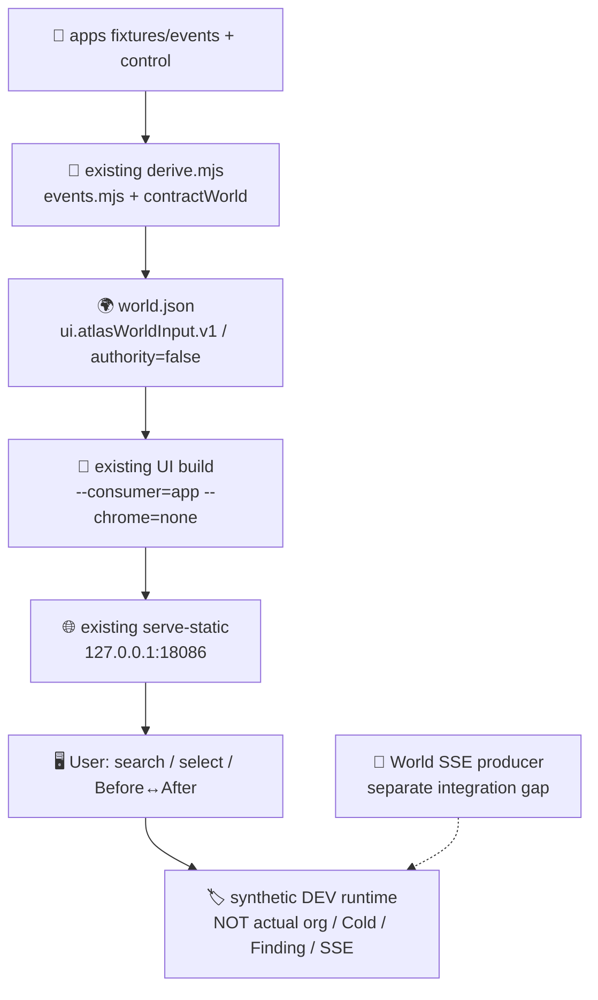

# Atlas local development runtime

This is the existing Atlas **derivation** pipeline opened as a local browser
runtime. It uses the repository's own `derive.mjs` over the checked-in
`fixtures/events` data, the existing UI builder, and the existing static server.
It is a synthetic development milestone: it does not read a live organization, Git
Cold, a Contract Finding, a provider, or Snapshot SSE, and `authority` stays false.

## Data scope

- Input: `packages/atlas/fixtures/events/events.jsonl` and
  `packages/atlas/fixtures/events/control.jsonl`.
- The World is produced by `derive.mjs` -> `events.mjs` + `contract.mjs`
  (`contractWorld`); it is `ui.atlasWorldInput.v1`, `authority: false`, and carries
  the derived phases, gap and `UNKNOWN` reasons for its frames.
- The source mode is synthetic. Current/UNKNOWN, unassigned units, and closed
  differences are shown as derived, not as accepted production truth.
- No Finding is fabricated, and no comparator, ledger, second authority, or SSE
  broker is added here.

## Prerequisites

- Native Node.js.
- An apps checkout that contains `packages/atlas/derive.mjs`.
- A read-only UI checkout containing `scripts/build-live-atlas.mjs` and
  `scripts/serve-static.mjs`, with `--consumer=app --chrome=none` support. The
  commands were exercised with UI `d2895bd89e9fe9af5cdf5fbbf543a9ff24791a74`; this
  is a development checkout, not an adoption claim, and the repository adds no UI
  flake pin.

## Run

Use a fresh, absent site directory per launch. `derive.mjs` writes its outputs
atomically; `build-live-atlas` refuses an existing output directory.

```sh
set -euo pipefail

cd /path/to/apps

NODE=${NODE:-node}
UI_ROOT=/path/to/ui-dev

RUN_ROOT=$(mktemp -d /tmp/atlas-dev-core.XXXXXX)
OUT="$RUN_ROOT/out"
SITE="$RUN_ROOT/site"

"$NODE" packages/atlas/derive.mjs --out-dir="$OUT" \
  packages/atlas/fixtures/events/events.jsonl \
  packages/atlas/fixtures/events/control.jsonl

cd "$UI_ROOT"

"$NODE" scripts/build-live-atlas.mjs \
  --consumer=app \
  --chrome=none \
  --input="$OUT/world.json" \
  --out="$SITE"

"$NODE" scripts/serve-static.mjs \
  --host=127.0.0.1 \
  --port=18086 \
  --root="$SITE"
```

Open <http://127.0.0.1:18086/>.

Expected: the derive receipt is `atlas.events-derive-build/1` with
`status: PASS`, `authority: false` and non-empty `frames`; the build receipt is
`live-atlas-build/1` with `status: PASS`, `inputKind: ui.atlasWorldInput.v1`,
`chrome: none` and `authority: false`. The build's `input.sha256` is the digest of
the exact `world.json` bytes; the embedded `#live-atlas-input` JSON is the UI
parser's normalized form, so compare through the receipt digest, not raw bytes.

The static server prints a line naming its loopback URL, for example
`purpose-atlas-host http://127.0.0.1:18086/`.

## Optional real-ledger path

When a real ledger exists, the same World can be derived from it instead of the
checked-in fixture, without changing the UI steps:

```sh
"$NODE" packages/atlas/live.mjs --out-dir="$OUT" \
  --ledger=/path/to/ledger.jsonl \
  --control=/path/to/control.jsonl
```

Use `$OUT/world.json` for the same `build-live-atlas` and `serve-static` commands.
The World is still `authority: false`; this is not an assertion of production,
organization, Cold, or Finding truth.

## Failure behavior

- Malformed, duplicated, or future-dated events make `derive.mjs` fail closed and
  write no replacement output.
- Missing or unreadable inputs, or a missing UI script, fail non-zero.
- An existing `--out` fails with `EEXIST`; an occupied port fails with
  `EADDRINUSE`. Choose another explicit loopback port and do not kill an unrelated
  listener.
- Absent, stale, or unmatchable observations stay `UNKNOWN` with their derived
  reason. `gap.parts` is `null`, not empty, when there is no ideal state to compare.

## Live SSE boundary

The UI accepts `?events=<SSE URL>` and already consumes World `snapshot` events.
No World SSE producer was found in this apps Atlas checkout or in the inspected
`ops.git` ref `bef92fe` worktrees; this is not a global claim about all Ops code.
Do not pass `?events=` and claim a live connection. A producer is a separate
data-integration gap, not something this README creates.

## Provenance and stop

Record the actual checkouts as information only; native Git refs are the
provenance, and there is no hard-coded SHA gate:

```sh
git -C /path/to/apps rev-parse HEAD
git -C "$UI_ROOT" rev-parse HEAD
git -C "$UI_ROOT" status --porcelain
```

Stop the static server with `Ctrl-C`, or send `SIGINT`/`SIGTERM` to its captured
PID when detached, and confirm it is gone. Never use a repository-wide kill.


